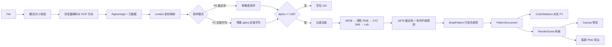

# 拼豆图纸生成工具：核心算法设计（P03）

| 项目 | 内容 |
| --- | --- |
| 文档版本 | v1.1（P05 核心实现对齐） |
| 日期 | 2026-11-06 |
| 阶段 | P03 技术设计，不包含业务编码 |
| 关联文档 | `docs/architecture.md`、`docs/data-model.md`、`docs/requirements.md` FR-02 至 FR-10 |
| 目标 | 定义可复现、可测试、与页面解耦的图片到图纸算法链路 |

## 1. 范围与定义

本文覆盖：

- 图片解码后的校验与方向处理；
- contain 坐标映射；
- 最近邻与区域平均采样；
- alpha 阈值、白底合成；
- sRGB → CIELAB → ΔE 颜色匹配；
- 图纸矩阵与空位生成；
- 统计、编辑/重映射的派生规则；
- 预览与 PNG 共用的渲染/导出约束；
- 性能复杂度和测试向量。

P05 已实现可选的 Floyd–Steinberg 策略；默认仍为无抖动。PDF 分页和自动分板仍不在本阶段范围。

数据口径：

- 源图像素来自浏览器解码后的 8-bit RGBA；RGB 按 sRGB 解释，alpha 是非预乘的 0-255。
- `A < 128` 为空位；`A >= 128` 为有效格。阈值是整数比较，不使用 `A > 128`。
- 有效格在白底上合成后进入颜色匹配。
- 空位不参与匹配、不进入材料清单、不产生色号。

## 2. 完整处理链路



链路约束：

- 解码、采样、匹配、构建、统计、布局是顺序依赖；不得从 UI 另行拼接颜色。
- 预览和导出从同一个 `PatternDocument` 开始；不得从预览 Canvas 反读像素作为导出输入。
- 统计和渲染都是派生步骤，失败时不得修改已生成的 `BeadPattern`。

### 2.1 模块输入、输出与依赖

| 模块 | 输入 | 输出 | 依赖 |
| --- | --- | --- | --- |
| `ImageDecoder` | `File`、解码上限 | `RgbaImage`、`SourceImageMeta` | 浏览器图片解码、EXIF 方向 |
| `ContainMapper` | 源尺寸、目标尺寸 | 每格源坐标矩形/中心点 | 无 DOM；纯数学 |
| `NearestSampler` | `RgbaImage`、映射矩形 | 单像素 RGBA 或空位 | `ContainMapper` |
| `AreaSampler` | `RgbaImage`、映射矩形 | 预乘平均 RGBA 或空位 | `ContainMapper`、线性化函数 |
| `AlphaCompositor` | 有效采样 RGBA、白底 | 白底合成的 `Rgb8` | sRGB/线性光转换 |
| `ColorSpace` | `Rgb8` | `Lab` | 固定 sRGB/D65 矩阵 |
| `ColorMatcher` | 源 Lab、色盘预计算 Lab | 色盘索引 | `Palette`、距离函数 |
| `PatternBuilder` | 目标格结果、索引、options、source meta | `BeadPattern` | 上述采样/匹配模块 |
| `StatisticsService` | `PatternDocument` | `ColorStatistics` | 色盘、cells；不依赖 UI |
| `SceneLayout` | `PatternDocument`、RenderOptions | `RenderScene` | 只读模型、字体度量约束 |
| `CanvasRenderer` | `RenderScene`、目标 Canvas | 屏幕/离屏绘制 | Canvas 2D |
| `PngExporter` | 不可变 `PatternDocument`、ExportOptions | `ExportResult`/Blob | `SceneLayout`、CanvasRenderer |

## 3. 图片读取与预处理

### 3.1 输入校验

输入：用户选择的 `File`、解码策略。

处理顺序：

1. 文件大小不得超过 20 MB。
2. 允许 PNG、JPEG、WebP；通过 MIME 和实际解码双重判断，不能只看扩展名。
3. 使用 `createImageBitmap(file, { imageOrientation: 'from-image', colorSpaceConversion: 'default', premultiplyAlpha: 'none' })` 解码；不支持时回退为 HTMLImageElement + Canvas。
4. 使 EXIF 方向在画布上完成；后续算法只读取已摆正的像素。
5. `width × height` 不得超过 16,777,216；超限立即拒绝，不创建超大中间 Canvas。
6. 将图像绘制到同尺寸 `OffscreenCanvas`/隐藏 Canvas，调用 `getImageData` 取得非预乘 RGBA。
7. 计算透明像素比例等诊断信息，供 UI 展示。
8. 及时释放 `ImageBitmap` 和临时 Canvas 引用。

输出：

```ts
interface RgbaImage {
  width: number;
  height: number;
  data: Uint8ClampedArray; // [r,g,b,a] × 像素数
}
```

不在预处理阶段做：

- 自动抠图、背景移除、锐化、降噪、自动对比度；
- 自动替换透明背景为白色；
- 根据“像不像照片”偷偷切换采样模式；
- 把浏览器平滑后的缩略图当作算法输入。

### 3.2 色彩管理

- `createImageBitmap` 使用浏览器默认色彩管理；带 ICC 的图片以浏览器解码结果为准。
- P0 将解码结果视为 sRGB 参考色，D-05 已确认不做显示器校色承诺。
- 颜色匹配前必须显式执行 sRGB 线性化，不直接在线性 RGB 和 sRGB 字节之间混算。
- 预览源图和图纸使用同一 sRGB 假设；不能对源图套 CSS 滤镜后再匹配。

## 4. contain 坐标映射

### 4.1 目的

目标图纸始终保持用户选择的 `Wt × Ht` 格；源图按比例缩放到目标内部，剩余区域为空位。P0 不裁切、不拉伸；用户选择 64×64 时必须得到 64×64，而不是“按图片比例偷偷变成 64×32”。

### 4.2 公式

源图尺寸 `Ws × Hs`，目标尺寸 `Wt × Ht`：

```text
scale       = min(Wt / Ws, Ht / Hs)
contentW    = Ws × scale
contentH    = Hs × scale
offsetX     = (Wt - contentW) / 2
offsetY     = (Ht - contentH) / 2
```

目标格 `(x, y)` 覆盖 `[x, x+1) × [y, y+1)`。其源坐标矩形为：

```text
sx0 = (x - offsetX) / scale
sx1 = (x + 1 - offsetX) / scale
sy0 = (y - offsetY) / scale
sy1 = (y + 1 - offsetY) / scale
```

最近邻采样点取格中心：

```text
cx = (x + 0.5 - offsetX) / scale
cy = (y + 0.5 - offsetY) / scale
```

若 `cx`/`cy` 不在 `[0, Ws)`/`[0, Hs)`，该格为空位。区域平均模式按裁剪后的矩形计算重叠面积；完全无交集的格为空位。

### 4.3 示例

8×4 源图、64×64 目标：

```text
scale = min(64/8, 64/4) = 8
contentW = 64
contentH = 32
offsetX = 0
offsetY = 16
```

因此源图占用第 16-47 行，上下各 16 行为空位；任何实现若把源图拉伸到 64 行或裁剪顶部/底部，均不满足 AC-06。

## 5. P0 最近邻采样与透明规则

### 5.1 单像素读取

对目标格中心 `(cx, cy)`：

```text
sx = clamp(floor(cx), 0, Ws - 1)
sy = clamp(floor(cy), 0, Hs - 1)
offset = (sy * Ws + sx) * 4
```

取 `r,g,b,a` 四个字节。由于 `RgbaImage` 是非预乘 alpha，`r/g/b` 是源色分量，alpha 是覆盖率。

### 5.2 空位判断

```text
if (a < 128) -> null
else -> valid source pixel
```

不在 alpha < 128 时读取颜色，也不把空位填成 `[255,255,255]` 的白色豆。

### 5.3 白底合成

对有效像素，先按 sRGB 显示空间做普通 alpha 合成：

```text
alpha = a / 255
rOut = round(r × alpha + 255 × (1 - alpha))
gOut = round(g × alpha + 255 × (1 - alpha))
bOut = round(b × alpha + 255 × (1 - alpha))
```

结果 `[rOut,gOut,bOut]` 保存为 `PatternCell.sourceRgb`。P0 最近邻不做颜色平均，因此不会因“缩小照片”制造新的中间色；半透明边缘只与白底合成。

### 5.4 P0 禁止事项

- 不使用浏览器默认平滑缩放直接影响匹配输入；
- 不把 alpha 通道丢弃后取 RGB；
- 不对 RGBA 的四个通道做同一个简单平均后当作源色；
- 不把 `A=127` 判为有效格；
- 不把 `contain` 留白误认为源图透明区域；两者在模型中都为 `null`，但成因记录在诊断信息中供 UI 说明。

## 6. P1 区域平均采样

区域平均仅在用户选择“照片”模式或显式接受建议时使用，不能悄悄替代 P0 最近邻。

### 6.1 权重

目标格映射到源坐标矩形 `[sx0,sx1)×[sy0,sy1)`。对每个与矩形相交的源像素 `(sx,sy)`，像素覆盖 `[sx,sx+1)×[sy,sy+1)`，其重叠面积为：

```text
wx = max(0, min(sx1, sx+1) - max(sx0, sx))
wy = max(0, min(sy1, sy+1) - max(sy0, sy))
weight = wx × wy
```

### 6.2 预乘 alpha 与线性光

先保留 alpha，避免透明边缘把背景颜色混进颜色：

```text
a = alphaByte / 255
linearR = srgbToLinear(r / 255)
linearG = srgbToLinear(g / 255)
linearB = srgbToLinear(b / 255)

sumW       += weight
sumAlpha   += weight × a
sumR       += weight × a × linearR
sumG       += weight × a × linearG
sumB       += weight × a × linearB
```

最终：

```text
avgAlpha = sumAlpha / sumW
avgR = sumR / sumW
avgG = sumG / sumW
avgB = sumB / sumW
```

`avgAlpha` 四舍五入到 0-255 后与 128 比较；小于 128 则空位。有效格再将平均预乘颜色合成到白底（线性光）：

```text
outLinearR = avgR + (1 - avgAlpha) × 1
outLinearG = avgG + (1 - avgAlpha) × 1
outLinearB = avgB + (1 - avgAlpha) × 1
outRgb = linearToSrgb(outLinearR/G/B)
```

这样透明边缘是“颜色+透明度”一起参与平均，而不是把 transparent black 混成黑边；先预乘再做线性平均，避免深色/高饱和边缘出现彩边或暗边。

### 6.3 范围约束

- 平均窗口只覆盖当前目标格对应的源矩形，不跨格取样。
- 不引入高斯模糊、锐化、超采样以外的滤波核；P1 目标是平滑照片，不是风格化。
- 区域平均后仍然逐格最近色匹配，不启用 Floyd–Steinberg。
- 如果 P1 实现与上述公式不一致，必须新增策略版本并在导出元数据中记录，不能静默改变同一 `generationKey` 的结果。

## 7. sRGB → CIELAB

### 7.1 线性化

对每个 sRGB 通道 `c ∈ [0,1]`：

```text
linear = c <= 0.04045
  ? c / 12.92
  : ((c + 0.055) / 1.055) ^ 2.4
```

### 7.2 XYZ（D65）

```text
X = 0.4124564 × Rlin + 0.3575761 × Glin + 0.1804375 × Blin
Y = 0.2126729 × Rlin + 0.7151522 × Glin + 0.0721750 × Blin
Z = 0.0193339 × Rlin + 0.1191920 × Glin + 0.9503041 × Blin
```

以 D65 白点 `Xn=0.95047, Yn=1.00000, Zn=1.08883` 归一化：

```text
fx = f(X / Xn)
fy = f(Y / Yn)
fz = f(Z / Zn)

f(t) = t > (6/29)^3
  ? t^(1/3)
  : (t / (3 × (6/29)^2)) + 4/29

L* = 116 × fy - 16
a* = 500 × (fx - fy)
b* = 200 × (fy - fz)
```

实现可用等价常数，但必须用同一 D65 白点和同一矩阵；不得随手使用 D50 常数。

### 7.3 缓存策略

- 色盘 67 个 `displayRgb` 在色盘解析后一次性转为 `Lab[]`。
- 每个目标格只计算一次源 `Lab`。
- 匹配循环只做 `L/a/b` 差值和乘加，不做字符串、对象分配或 DOM 操作。
- 调试输出可保留 `sourceRgb` 和匹配索引，但不把 Lab 数组塞进每格。

## 8. 颜色匹配

### 8.1 CIE76

对源 Lab `(L1,a1,b1)` 与色盘 Lab `(L2,a2,b2)`：

```text
distanceSquared = (L1-L2)^2 + (a1-a2)^2 + (b1-b2)^2
```

选择最小 `distanceSquared` 的色盘索引。无需开方，不改变排序。

平局规则：

- 若距离差在 `1e-9` 内，视为平局；
- 平局按官方 `code` 的固定字典序升序；
- 不按数组位置、不按名称、不使用随机数；
- 结果必须与 AC-11 的连续生成一致。

### 8.2 匹配器接口

```ts
interface PreparedMatcher {
  match(rgb: Rgb8): number; // 返回 Palette.colors 索引
}
```

- `match` 不知道 UI、文件名或画布；
- 匹配器只接收 RGB 或预转换的 Lab，输出索引；
- 色号字符串由 `palette.colors[index].code` 解析；
- P0 只注册 `cie76`；`ciede2000` 在 P2 用同一接口和独立版本号注册。

### 8.3 P2 CIEDE2000 的设计边界

- 必须使用公开公式的独立参考实现做数值测试；
- 必须显示策略名称和前后差异，不把“CIEDE2000”作为“更准”营销词；
- 必须记录算法 id/参数/版本到导出元数据；
- 同一色盘和输入下依然确定性；平局规则保持一致；
- 不能在不改变版本和验收的情况下替换 P0 匹配器。

### 8.4 不做的事

- 不先按 RGB 粗筛再声称是 CIELAB 精确结果，除非粗筛只用于性能优化且最终仍与全量搜索逐格一致；
- 不对色盘颜色做运行时随机扰动；
- 不把两个相近色号合并后仅显示其中一个；
- 不在 UI 层用“看起来差不多”覆盖算法结果。

## 9. 普通量化与抖动

P0 采用**逐格独立最近色量化**：

- 每格只看自己的源色；
- 选择色盘最小距离；
- 不把误差扩散到邻居；
- 统计和导出能逐格解释。

Floyd–Steinberg 的设计后果：

- 当前格量化误差按权重扩散到右、下、右下、左下等邻居；
- 结果依赖扫描顺序，且单格不再是最接近色；
- 在实体拼豆上容易形成视觉噪点和额外颜色；
- 会增加材料清单分散度，且难以向用户解释“为什么这个格不是最近色”。

P0/P1 均不启用误差扩散；P2 若实现，必须：

1. 作为独立策略而不是默认；
2. 明确显示扫描顺序和误差范围；
3. 在导出元数据记录策略、版本和参数；
4. 重新验收数量、色号可读性和空位规则；
5. 不因抖动改变透明空位的判定。

### 9.1 P05 可选实现

当前核心已按上述约束实现 `dithering = 'floyd-steinberg'`，行优先扫描，使用固定 7/16、3/16、5/16、1/16 权重。默认值仍为 `'none'`，P0 验收结果不变；详细边界见 ADR-0012。误差只写入非空格的浮点工作缓冲，`PatternCell.sourceRgb` 始终保留抖动前采样色。

## 10. 图纸矩阵生成

输入：

- `RgbaImage`；
- `Palette`（已校验）；
- `PatternOptions`（P0 合法值）；
- `SourceImageMeta`；
- `PreparedMatcher`。

输出：`BeadPattern`。

步骤：

1. 校验目标尺寸和 options；不合法直接抛出 `GENERATION_FAILED` 或对应字段错误。
2. 按行优先创建 `cells` 数组，初始为 `null`。
3. 对每个目标格计算 contain 映射。
4. 调用最近邻或区域平均，得到 `null` 或白底合成后的 `Rgb8`。
5. 有效色转换 Lab，调用匹配器得到 `colorIndex`。
6. 创建 `PatternCell { colorIndex, sourceRgb, origin: 'auto' }`。
7. 所有格完成后统计有效格数；为 0 时抛出 `EMPTY_PATTERN`，不返回空图纸。
8. 从 options、sourceId、paletteRef.checksum 和算法版本生成 `generationKey`。
9. 生成 `PatternDocument(pattern, palette)`；`stateVersion` 初始为 1，`createdAt` 为 ISO 字符串。

行优先索引：

```text
cellIndex = row × width + column
```

不存第二个 `row/column` 字段；需要时从 index 派生。这样编辑和序列化更紧凑，也避免行列与索引不一致。

## 11. 颜色统计

输入 `PatternDocument`，输出 `ColorStatistics`。

算法：

1. 建立长度等于 `palette.colors.length` 的 `Uint32Array` 计数。
2. 遍历 `cells`；`null` 只增加 `emptyCount`，不增加逐色计数。
3. 非空 cell 的 `colorIndex` 递增计数；越界立即报数据损坏。
4. `beadCount = total - emptyCount`。
5. 将 count > 0 的颜色转成 `ColorCount`，按 count 降序、code 升序排序。
6. 返回带 `patternStateVersion` 和 `paletteChecksum` 的只读统计。

这保证了 AC-P1-08 的编辑同步：编辑后重新计算，不维护一个独立的“数量缓存”。16,384 格的全量统计是一次 O(n) 数组扫描，远比同步风险便宜。

## 12. 编辑与品牌重映射

### 12.1 单格编辑（P1）

输入：`PatternDocument`、cellIndex、新 colorIndex 或 `null`。

规则：

- 改为空位：cell 变为 `null`，`beadCount` 减一。
- 改为合法色号：`colorIndex` 更新，`origin` 变为 `manual`；若原 cell 有 `sourceRgb`，保留它作为原始采样色。
- 由空位改为色号：`sourceRgb` 为 `null`，因为该格没有自动采样来源。
- 不允许传入色盘外索引；错误在编辑前阻止。
- 每次用户动作生成一个新的 `stateVersion`；统计和图例用新版本重算。
- 撤销/重做保存编辑前后的单格值；数量由图派生，不单独回滚数字。

### 12.2 品牌重映射（P2）

前置条件：存在第二品牌真实、已校验色盘，且 `sourceRgb` 可用。

规则：

1. 空位保持空位。
2. `origin === 'auto'` 且有 `sourceRgb`：从 `sourceRgb` 重新匹配目标色盘。
3. `origin === 'manual'`：默认保留原色号并标记“未随品牌切换”；D-06 已确认。
4. 用户显式选择“全部重算”时：
   - 有 `sourceRgb` 的格子按源色重算；
   - 没有 `sourceRgb` 的手工格无法推导源色，保留并报告“未重算”，不能伪造源色。
5. 新 `BeadPattern.paletteRef` 指向目标色盘；`sourceRgb` 不因换色而丢弃。
6. 生成新的 `stateVersion`，重新统计并导出带目标品牌元数据的图纸。

## 13. 渲染与导出一致性

### 13.1 统一场景

`buildRenderScene(document, options)` 输出纯数据场景：

- 画布尺寸、纸张/工作台背景；
- 标题与行/列标尺；
- 每格矩形、网格线坐标、主网格线级别；
- 每格色号文字、文字颜色/描边；
- 空位纹理；
- 图例色块、code、官方名、可选数量；
- 色盘来源、生成时间、状态版本等脚注。

Canvas 渲染器只遍历场景绘制；不允许预览路径和导出路径各写一份“怎么画”的方法。

### 13.2 预览缩放

- 预览缩放只改变视口和绘制比例，不改变 `PatternDocument`。
- 当 CSS 格宽小于产品阈值（建议 < 14 px）时可以隐藏格内数字，但界面必须提示导出图仍含完整色号。
- 100% 预览与导出采用同一色号规则、同一字体层级、同一空位纹理；区别只是导出固定格宽 ≥ 40 px、无 DPR 缩放。
- 缩放、滚动和悬停不重新匹配颜色，也不改变 `stateVersion`。

### 13.3 导出快照

1. 点击导出时取得 `document` 的不可变引用和 `stateVersion`。
2. 计算画布尺寸；若超限，抛出 `EXPORT_TOO_LARGE`。
3. 使用离屏 Canvas 从 `RenderScene` 重绘全部内容；不复用屏幕 Canvas。
4. 每个有豆格绘制完整官方 code；空位不绘制数字。
5. 图例、行列号和来源脚注均在同一张 PNG 中。
6. `toBlob('image/png')` 生成 Blob；Blob 为空或类型错误则失败。
7. 创建 object URL 触发下载，完成或失败后 revoke。
8. 返回 `stateVersion`；若用户在导出期间编辑，下次导出使用新版本，前一张不能被混改。

## 14. PNG 与 PDF 的实现边界

### 14.1 PNG（P0）

- 导入：原生 Canvas 2D、`OffscreenCanvas` 或隐藏 Canvas。
- 编码：`canvas.toBlob(callback, 'image/png')`；不使用 `toDataURL` 作为常规下载路径，避免 base64 内存膨胀。
- 下载：`Blob` + `URL.createObjectURL` + 临时 `a[download]`。
- 字体：使用本地系统字体；导出前等待 `document.fonts.ready`。
- 禁止：`html2canvas`、截图当前滚动区域、只导出可见格子。

### 14.2 PDF（P2，不进入 P0 依赖）

可选路径：

- **矢量优先**：`pdf-lib` 创建页面，线/矩形/文字由 `RenderScene` 映射；适合精确打印，但需字体嵌入与子集化。
- **栅格保底**：把同一 PNG/高分辨率页面嵌入 PDF；实现稳，但文件更大、不是矢量。
- 不采用浏览器“打印为 PDF”作为唯一导出，因为页边距、分页和用户设置不可控。

P2 PDF 仍必须沿用同一 `RenderScene`、同一色号/图例/空位规则，并通过分页/裁切验证，不得另建颜色逻辑。

## 15. 复杂度与性能

| 步骤 | 复杂度 | 64×64 规模 | 128×128 规模 |
| --- | --- | --- | --- |
| 最近邻采样 | O(Wt × Ht) | 4,096 次 | 16,384 次 |
| 区域平均 | O(源像素 + Wt × Ht + 边界重叠) | 取决于源图面积 | 取决于源图面积 |
| CIE76 匹配 | O(Wt × Ht × 67) | 274,432 距离 | 1,099,264 距离 |
| 统计 | O(Wt × Ht) | 4,096 次 | 16,384 次 |
| 预览绘制 | O(可见格数 + 图例) | 通常 4,096 格 | 通常视口裁剪 |
| PNG 导出 | O(全部格数 + 图例) | 一次离屏绘制 | 受 Canvas 内存预算约束 |

实现策略：

- 色盘 Lab 缓存；目标格 Lab 只算一次；
- 扁平数组索引，避免内层循环创建对象/闭包；
- 预览不因 mousemove 重绘静态网格；
- 导出先做像素预算检查再分配；
- 若 128×128/区域平均/CIEDE2000 让主线程长任务明显超过 150-200 ms，按 ADR-0007 进入 Worker 评估，不提前复杂化 P0。

## 16. 测试向量与断言

### 16.1 alpha 与 contain

- `A=0,1,127`：必须为 `null`，无 code。
- `A=128,129,255`：必须为有效格并有合法索引。
- 8×4 图对 64×64：内容区行 16-47，其余 `null`。
- 全透明：生成抛出 `EMPTY_PATTERN`，没有可导出的图纸。
- 相同 alpha 值在最近邻路径与文档声明一致；不能用 `A>128` 代替 `>=128`。

### 16.2 颜色

- 纯黑、纯白、中间灰在色盘自匹配中回到自身（使用冻结色盘）。
- 用独立参考实现核对至少 12 个 Lab/ΔE76 数值。
- 距离相同的人工色由官方 code 字典序稳定选择。
- 同输入、同色盘、同参数连续 3 次逐格索引完全一致。
- RGB 欧氏距离的快捷结果不得冒充 CIELAB 测试结果。

### 16.3 区域平均（P1）

- 不透明纯色区域：平均结果等于该色（允许 8-bit 舍入误差）。
- 半透明边缘：不出现因 transparent black 平均导致的黑色彩边。
- 透明平均 alpha <128：空位；>=128：有效格。
- 源图为 2×2 黑白相间、目标 1×1 时，结果应符合文档中的线性光平均公式，而非简单的 sRGB 字节平均。
- 两种模式在 `fixture-photo.jpg` 上产生可见不同的结果，但都不启用抖动。

### 16.4 统计与导出

- 非空 cell 数等于 `beadCount`，`beadCount + emptyCount = width × height`。
- 把 A 色 10 格改为 B 色、再 2 格改为空位，统计差异为 A -10、B +8、总豆数 -2。
- 导出 PNG 签名、尺寸、网格线、色号、图例、空位和来源脚注存在。
- 同一 `PatternDocument` 连续导出两次的可用性一致；导出期间修改图纸不混入旧快照。
- 预览与导出抽取 10 个格子，色号、色块、空位一致。

## 17. 错误与边界处理

| 情况 | 处理 | 不能做什么 |
| --- | --- | --- |
| 文件格式不支持/伪装 | `UNSUPPORTED_IMAGE`，不进入生成 | 用扩展名猜成功 |
| 解码失败 | `IMAGE_DECODE_FAILED`，保留旧图 | 显示空白成功图 |
| 像素/文件超限 | `SOURCE_LIMIT_EXCEEDED`，提示缩小 | 先创建超大 Canvas |
| 全透明/无有效格 | `EMPTY_PATTERN`，不生成 | 用白色豆补满 |
| 色盘校验失败 | `PALETTE_INVALID`，禁用匹配/导出 | 使用部分色号 |
| 索引越界 | `GENERATION_FAILED`，阻止导出 | 回退到 0 或白色 |
| 导出尺寸超限 | `EXPORT_TOO_LARGE`，不分配画布 | 静默降格/删色号 |
| `toBlob` 返回空 | `EXPORT_ENCODE_FAILED` | 下载 0 字节成功文件 |
| 下载对象 URL 失败 | `EXPORT_DOWNLOAD_FAILED`，可重试 | 认为已成功 |
| 旧请求返回 | 丢弃，不写入状态 | 覆盖新图纸 |

## 18. 需求映射

| 算法步骤 | 需求/验收 |
| --- | --- |
| 文件与像素读取 | FR-01、FR-02；AC-01 至 AC-03 |
| alpha 阈值与白底合成 | FR-03；AC-04、AC-13 |
| contain 与最近邻 | FR-04；AC-05、AC-06 |
| CIELAB/CIE76 | FR-06；AC-10、AC-11 |
| 逐格索引与可追溯 | FR-07；AC-12、AC-17 |
| 网格、行列号、图例 | FR-08；AC-15 至 AC-19 |
| 统计派生 | FR-09；AC-P1-01、AC-P1-08 |
| PNG 快照与离屏重绘 | FR-10；AC-20 至 AC-23、AC-P1-09 |
| 区域平均 | FR-15；AC-P1-07 |
| 重映射 | FR-16；AC-P2-01 |

## 19. 设计冻结点

以下修改必须走显式变更控制：

- alpha 阈值从 128 改为其他值；
- contain 改为裁剪/拉伸默认；
- 最近邻改为默认区域平均或平滑；
- sRGB 线性化矩阵/白点改变；
- 匹配从 CIE76 改为 CIEDE2000 或加抖动；
- 空位从 `null` 改为颜色索引；
- 预览/导出不再共享 `RenderScene`；
- 导出从离屏重绘改为截图。
