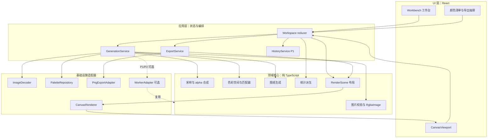

# 拼豆图纸生成工具：总体技术架构（P03）

| 项目 | 内容 |
| --- | --- |
| 文档版本 | v1.1（P04 实现对齐） |
| 日期 | 2026-11-06 |
| 阶段 | P03 技术设计，不包含业务编码 |
| 需求基线 | `docs/requirements.md` v1.1、`docs/acceptance.md` v1.1、`docs/feature-priority.md` v1.1、`docs/product-design.md` v1.0 |
| 已冻结决策 | C-01 至 C-03、D-01 至 D-06 |
| 交付目标 | 纯前端 P0 闭环可独立测试；P1/P2 有清晰扩展点，但不提前实现 |

## 1. 技术结论

推荐方案：

**React + TypeScript（strict）+ Vite + Canvas 2D + Tailwind CSS + 纯 TypeScript 领域核心 + 内置经校验色盘 JSON，纯前端运行。**

各选择的边界：

- React 只负责应用状态和界面，不承担像素处理；Canvas 2D 只负责绘制。
- 图片解码、采样、颜色空间转换、色盘匹配、统计和渲染布局都放在与 DOM 解耦的模块中。
- P0 不使用 Web Worker、不引入后端、数据库、AI API、第三方颜色匹配库或 PDF 库。
- P0 只导出 PNG；未来 PDF 由独立适配器实现，不把 PDF 依赖塞进主流程。
- 色盘是冻结的官方来源快照；品牌色号与派生 RGB 分离，每个格子保存色盘索引和源色。

这套方案不是“因为用户提了 React 就接受”。评估结论是：本项目真正困难的是一致性、颜色算法、网格可读性和导出一致性，而不是 UI 框架；React 的价值在于降低复杂界面状态与异步状态的实现风险，Canvas 的价值在于处理数千到数万格的生产图纸。若团队完全不具备 React 经验，Vue/Svelte 也能完成同一架构，但不应在 72 小时内为框架偏好重写核心模块。

## 2. 技术选型评估

### 2.1 React 与其他前端方案

| 方案 | 开发成本 | 性能 | 维护/生态 | 对本项目的判断 |
| --- | --- | --- | --- | --- |
| React + TypeScript + Vite | 中低；熟悉的组件和状态生命周期成熟 | UI 状态性能足够；重绘在 Canvas，不在 React DOM | 生态最大，测试/类型工具成熟 | **选择**。适合三栏工作台、异步生成状态、抽屉、错误态和 P1 编辑 |
| Vanilla TypeScript + Vite | 初始低，后续状态和 DOM 同步成本高 | 最轻，减少框架开销 | 手写可访问性和复杂交互容易失控 | 不选；省下的 KB 不足以抵消 72 小时内的维护风险 |
| Preact | 接近 React，包更小 | 足够 | 兼容层和团队经验是额外风险 | 不选；本地工具不吃这一点包体，稳定性优先 |
| Svelte | 中低，响应式直观 | 很好 | 团队不熟悉时有学习成本 | 可选替代；没有压倒性优势，换框架不解决核心问题 |
| SolidJS | 中，细粒度性能强 | 很好 | 生态和排障经验相对少 | 可选替代；Canvas 绘制使 UI 框架性能差异不关键 |
| Vue | 中低，生态完整 | 足够 | 适合表单和状态驱动界面 | 可选替代；若团队更熟 Vue，是合理的同等级选择 |

**决策依据**：相比“最快渲染”，本项目更需要在同一页面中可靠管理“草稿参数、已生成图纸、旧版本、异步导出、选中格和错误态”。React 的组件模型与单向状态流能把这些关系写清楚；TypeScript 则直接保护色盘索引、空位、导出选项等高风险数据。

不采用 Next.js、SSR 或后端渲染：P0 没有 SEO、账号、服务端图片处理或协作需求，增加运行形态只会扩大故障面。

应用状态优先使用 React 内置 `useReducer` + 单一 Workspace store，不引入额外全局状态库。若后续编辑历史或选择态导致 Context 重渲染成为实测瓶颈，再引入小型 selector store；当前不预支复杂度。样式采用 Tailwind CSS v4 + CSS Custom Properties，不引入 UI 组件库；Canvas 绘制细节不依赖 Tailwind（见 ADR-0010）。

### 2.2 Canvas 与 SVG

| 方案 | 绘制性能 | 交互/可访问性 | 导出 | 适用判断 |
| --- | --- | --- | --- | --- |
| Canvas 2D | 4096-16,384 格、色号和图例都在一个绘制平面，适合高频重绘 | 需自行命中测试；需要额外的文字摘要和 DOM 清单保证可访问性 | 直接生成 PNG；与离屏导出共用绘制命令 | **选择为主画布** |
| SVG | 格子和文字是 DOM 节点，64×64 即有 4k+ 节点，128×128 可达 16k+ 格子加文字 | 矢量缩放、DOM 事件和可访问性更好 | SVG 适合矢量化，但 PNG 仍需栅格化 | 不选为主画布；P2 可做 SVG/PDF 场景适配 |
| CSS Grid/DOM 方块 | 小图直观，大图 DOM 数量爆炸 | 交互实现简单 | 导出与屏幕截图容易分叉 | 不选；不能满足大图与导出一致性 |
| Canvas + DOM UI | Canvas 负责图纸，DOM 负责上传、参数、清单、提示和导出 | 兼顾性能和可访问性 | 图纸用 Canvas 场景渲染，图例数据由同一模型生成 | **最终选择** |

采用 **双 Canvas 分层**：底层绘制网格、色块、色号、行列标尺；上层只绘制选中框、悬停格和接缝参考。鼠标移动不应触发整张底图重绘。画布外提供真实 DOM 的颜色清单和文字摘要，保证屏幕阅读器与键盘操作有内容可读。

Canvas 的代价是：需要自行实现坐标命中、缩放、视口裁剪和文字布局；但这些逻辑与生产数据直接相关，反而更适合放在我们可控的 `RenderScene` 中。SVG 的“天然可访问”不能替代逐格色号的可读性验收。

### 2.3 颜色距离算法

| 算法 | 准确性 | 性能/成本 | 风险 | 适用性 |
| --- | --- | --- | --- | --- |
| RGB 欧氏距离 | 低；RGB 不是感知均匀空间，暗部、蓝色和肤色附近容易误选 | 最低 | 容易被用户看出“明明有更接近的色号” | 不用于产品匹配 |
| CIELAB ΔE76 | 中高；比 RGB 更符合感知，计算简单、可解释 | 低：每格每色一次平方距离；67 色量级可控 | 蓝紫区域和低色差区域不如 CIEDE2000 精细 | **P0 选择** |
| CIEDE2000 | 高；对低色差、色相和亮度权重更细致 | 中高：公式复杂，测试和对比成本高 | 改变“最接近”的结果口径，容易引发版本争议 | P2 作为显式策略；不作为 P0 默认 |

P0 冻结为 sRGB → 线性 RGB → D65 XYZ → CIELAB → ΔE76；转换必须在算法核心中明确实现，不使用浏览器 CSS 颜色差或 RGB 欧氏距离替代。色盘 Lab 值在每次匹配前预计算，避免逐格重复转换 67 色。

### 2.4 最近邻采样与区域平均采样

| 模式 | 输入适合度 | 结果特征 | 代价 | 优先级 |
| --- | --- | --- | --- | --- |
| 最近邻 | 硬边像素画、低分辨率图标 | 保留硬边和离散像素；缩小会丢弃部分像素 | 低；O(目标格数) | **P0 默认** |
| 区域平均 | 普通照片、连续渐变、大幅缩小 | 保留整体明暗，减少随机噪点；边缘会变柔 | 中；需处理预乘 alpha、分数边界和线性光 | P1 显式模式 |

不把“平滑”设为默认：对像素画使用双线性或区域平均会制造原图没有的过渡色，并把透明边缘变成彩边。P1 的区域平均只在用户选择“照片”模式或明确接受建议后启用；P0 保留最近邻并给出照片质量告警。

### 2.5 普通颜色量化与 Floyd–Steinberg 抖动

普通量化是“每个格子独立选择最接近的色盘颜色”，不把误差传播给邻居。Floyd–Steinberg 是误差扩散抖动：把当前格量化误差按固定权重分给右侧和下一行，制造视觉上的中间色。它能让照片看起来更细腻，但会：

- 让每个格子不再是该格源色的最近色；
- 产生棋盘格/噪点，实体拼豆上尤其明显；
- 让材料数量更分散，用户更难按颜色备豆；
- 改变匹配的可解释性，和 P0“最接近实体色”口径冲突。

P0 不启用任何抖动；P1 照片模式也只做区域平均后独立量化。Floyd–Steinberg 只能作为 P2 的显式“风格化/抖动”策略，单独验收、单独记录策略参数，不得偷偷混入默认流程。

### 2.6 Web Worker

P0 不强制使用 Worker。按 64×64、67 色计算，颜色距离最多约 274,432 次；即使加上采样和图例绘制，现代桌面 Chrome/Edge 通常在可接受范围内。引入 Worker 会带来结构化克隆、取消、错误序列化、构建产物和调试验证成本。

保留 Worker 的条件而不是提前实现：

- 128×128 区域平均 + CIEDE2000 或多品牌重映射导致一次生成 p95 超过 150-200 ms；
- 主线程在生成时出现明显掉帧，或用户连续调整参数产生长任务；
- 需要取消正在进行的 CPU 计算，而不只是忽略旧结果。

因此定义同一 `GenerationService` 接口，P0 使用主线程实现，后续可替换成 Worker 实现；领域核心不依赖 `document`、`window` 或 Canvas。Worker 只承载纯计算，不承载 React 和主要 UI。

### 2.7 PNG 与 PDF 导出

| 方式 | 优点 | 限制 | 结论 |
| --- | --- | --- | --- |
| Canvas 离屏导出 PNG | 与预览共享绘制规则；`toBlob` 本地下载；验收直接 | 大尺寸受 Canvas 内存/像素上限；不是矢量 | **P0 选择** |
| 浏览器打印为 PDF | 实现最少 | 受浏览器页边距、打印机、用户设置影响，难以保证内容完整 | 不用于产品导出 |
| jsPDF 生成 PDF | API 简单、体积较小 | 中文字体嵌入和布局控制有限，复杂图例排版容易变成手工坐标 | 备选 |
| pdf-lib 生成 PDF | 可控分页、矢量线、嵌入字体和元数据 | 需要字体子集/许可和额外布局代码，增加依赖 | P2 推荐方案 |
| SVG 导出 | 矢量、可再编辑 | 色号文字与字体依赖；不是原题 P0 必需 | P2 可做场景适配 |

P0 PNG 必须从 `RenderScene` 重绘，不截取网页 Canvas，不使用 `html2canvas` 之类截图方案。P2 PDF 优先从同一 `RenderScene` 生成矢量页面；若中文字体嵌入成本过高，则以高分辨率栅格页面嵌入 PDF 作为保底。任何 PDF 方案都不得另写一套色号/图例逻辑。

## 3. 总体架构

### 3.1 分层



### 3.2 依赖规则

| 层 | 可以依赖 | 禁止依赖 | 责任 |
| --- | --- | --- | --- |
| 领域核心 | 标准 ECMAScript、共享类型 | React、DOM、Canvas、File、Worker、网络 | 采样、色彩、匹配、图纸、统计、布局 |
| 基础设施 | 领域接口、浏览器 API | UI 组件、React state | 解码、色盘装载、Canvas 绘制、Blob 下载 |
| 应用层 | 领域核心 + 基础设施接口 | 直接改 Canvas 像素 | 请求编排、状态、错误、快照、历史 |
| UI 层 | 应用层公开动作和只读状态 | 自行计算匹配或数量 | 展示与用户交互 |

依赖必须单向：UI → 应用 → 领域；基础设施实现领域接口，由应用注入。领域核心不 import `react`、`document`、`window` 或浏览器类型，因此可在 Vitest/Node 中独立测试。

### 3.3 唯一可信数据源

运行时以 `PatternDocument` 为唯一图纸状态：

- `PatternDocument.pattern`：行列、每格索引/空位、源色、生成参数、版本。
- `PatternDocument.palette`：由 `paletteRef` 解析出的不可变色盘。
- 预览、统计、图例、编辑基础、PNG 导出全部读取这两个对象，不维护第二份颜色矩阵或数量矩阵。
- 任何生成、编辑、品牌重映射都会产生新的 `BeadPattern` 和递增的 `stateVersion`；不得原地静默修改旧快照。
- `ColorStatistics` 是派生只读视图，不是独立真相；导出时锁定 `stateVersion`。

## 4. 模块职责

| 模块 | 输入 | 输出 | 主要职责 |
| --- | --- | --- | --- |
| `ImageDecoder` | `File`、解码策略 | `DecodedImage` | 格式/大小校验、EXIF 方向、解码为 RGBA、资源释放 |
| `PaletteRepository` | `PaletteRef` / 默认 id | `Palette` | 装载内置 JSON、运行时校验、校验和一致性 |
| `SamplingEngine` | `RgbaImage`、目标尺寸、采样参数 | `SampledGrid` | contain 映射、最近邻/区域平均、alpha 阈值与白底合成 |
| `ColorMatcher` | 色盘、RGB/Lab | 色盘索引 | 预计算色盘 Lab、可替换匹配策略、确定性平局 |
| `PatternBuilder` | 采样网格、匹配结果、参数、source meta | `BeadPattern` | 生成唯一格子状态、空位、色盘引用、版本 |
| `StatisticsService` | `PatternDocument` | `ColorStatistics` | 从 cells 派生数量、总豆数、空位、用色数 |
| `SceneLayout` | `PatternDocument`、视图/导出参数 | `RenderScene` | 网格、色号、行列号、图例、标题的统一布局 |
| `CanvasRenderer` | `RenderScene`、Canvas 上下文 | 绘制结果 | 只负责把场景画到目标 Canvas；预览/导出共用 |
| `PngExportAdapter` | `PatternDocument`、`ExportOptions` | `Blob` | 离屏 Canvas、尺寸保护、`toBlob`、下载 |
| `GenerationService` | 源图、参数、色盘、信号 | `PatternDocument` | 串联纯核心；可替换为 Worker 实现 |
| `WorkspaceReducer` | 用户动作、异步结果 | 新工作区状态 | 管理草稿、已生成版本、错误、选中、导出状态 |

## 5. 项目目录结构

```text
src/
  app/
    App.tsx
    workspace/
      workspaceReducer.ts
      workspaceTypes.ts
      selectors.ts
    services/
      generationService.ts
      exportService.ts
      historyService.ts          # P1
    errors/
      appError.ts
      errorMessages.ts
  domain/
    model/
      geometry.ts
      image.ts
      palette.ts
      pattern.ts
      statistics.ts
      export.ts
    sampling/
      contain.ts
      nearest.ts
      area.ts
    color/
      srgb.ts
      lab.ts
      distance.ts
    matching/
      matcher.ts
      cie76.ts
      ciede2000.ts              # P2，接口预留
    pattern/
      buildPattern.ts
      editCell.ts               # P1
      remapPalette.ts           # P2
    statistics/
      computeStatistics.ts
    render/
      scene.ts
      sceneLayout.ts
  infrastructure/
    image/
      browserImageDecoder.ts
    palette/
      bundledPaletteRepository.ts
      validatePalette.ts
    render/
      canvasRenderer.ts
    export/
      pngExporter.ts
    worker/
      generationWorkerAdapter.ts  # P1/P2 可选
  workers/
    generation.worker.ts          # P1/P2 可选
  ui/
    workbench/
      Workbench.tsx
      CanvasViewport.tsx
      CanvasOverlay.tsx
    panels/
      UploadPanel.tsx
      OptionsPanel.tsx
      MaterialPanel.tsx
      ExportDrawer.tsx
    components/
    styles/
  data/
    palettes/
      hama-midi-solid-2026.json
      hama-midi-solid-2026.source.json
  main.tsx
tests/
  unit/
  fixtures/
  e2e/
docs/
  decisions/
```

目录不是按“技术炫技”分，而是按可测试性和依赖方向分：`domain` 可以在没有 UI 的情况下运行；`infrastructure` 可以换成测试替身；`ui` 不持有颜色算法。

### 5.1 P04 实际实现目录映射

项目初始化采用更简洁的物理目录，依赖方向和模块职责仍以 ADR-0002/0011 为准。实际映射如下：

| 实际目录 | 架构职责 |
| --- | --- |
| `src/core/image/` | `domain/sampling`、RGBA/alpha 纯规则；不包含浏览器解码 |
| `src/core/color/` | `domain/color`、`domain/matching`；色彩空间、距离与匹配器 |
| `src/core/pattern/` | `domain/pattern`、`domain/statistics`、图纸模型校验 |
| `src/core/errors/` | 可序列化领域错误 |
| `src/palettes/` | 色盘数据快照、仓库与运行时校验 |
| `src/adapters/image/` | `infrastructure/image`，浏览器 `File`/解码适配 |
| `src/render/` | `RenderScene`、场景布局与 Canvas 渲染适配 |
| `src/export/` | PNG 导出适配器 |
| `src/store/` | 工作区 reducer、选择器、状态快照 |
| `src/components/` | 工作台 UI；不得承担算法、统计或导出真相 |
| `src/types/` | 共享数据模型与模块契约 |

目录名可以压缩，依赖边界不能压缩：核心层仍禁止 import React/DOM/Canvas/File，预览和导出仍必须共享 `RenderScene`。

## 6. 核心模块接口

以下为接口约定，不是业务实现。

```ts
export interface ImageDecoder {
  decode(file: File, policy: DecodePolicy): Promise<DecodedImage>;
}

export interface DecodedImage {
  image: RgbaImage;
  meta: SourceImageMeta;
  release(): void;
}

export interface PaletteRepository {
  loadDefault(): Promise<Palette>;
  load(ref: PaletteRef): Promise<Palette>;
}

export interface ColorMatcherFactory {
  create(algorithm: MatcherId): ColorMatcher;
}

export interface ColorMatcher {
  readonly id: MatcherId;
  prepare(colors: readonly BeadColor[]): PreparedMatcher;
}

export interface PreparedMatcher {
  match(rgb: Rgb8): number;
}

export interface GenerationService {
  generate(
    request: GenerationRequest,
    signal?: AbortSignal,
  ): Promise<PatternDocument>;
}

export interface ExportService {
  exportPng(
    document: PatternDocument,
    options: ExportOptions,
    signal?: AbortSignal,
  ): Promise<ExportResult>;
}

export interface SceneRenderer {
  render(ctx: CanvasRenderingContext2D, scene: RenderScene): void;
}

export function generatePattern(input: GenerationInput): PatternDocument;
export function computeStatistics(document: PatternDocument): ColorStatistics;
export function buildRenderScene(
  document: PatternDocument,
  options: RenderOptions,
): RenderScene;
```

接口的职责边界：

- `ImageDecoder` 只返回像素和元数据，不判断色盘、不匹配颜色。
- `ColorMatcher` 返回色盘数组索引，不返回色号字符串；索引通过 `palette.colors` 解析。
- `PatternBuilder` 不读取 DOM、不画图；只产出版本化图纸。
- `SceneLayout` 不读全局状态；输入是显式图纸和渲染参数。
- `ExportService` 只接收不可变 `PatternDocument` 和选项，不读取工作台草稿。

## 7. 状态模型与界面协作

工作区状态分为“草稿”和“已生成快照”：

```text
WorkspaceState
  source: DecodedImage | null
  draftOptions: PatternOptions
  document: PatternDocument | null       // 已生成，唯一可信图纸
  generation: idle | generating | success | error
  export: idle | preparing | exporting | success | error
  selection: cell index | null           // P1
  history: undo/redo stack               // P1
```

规则：

- 参数改变只改 `draftOptions`，不直接改 `document`；界面显示“参数已改”。
- `document.pattern.options` 是“这张图纸是用什么参数生成的”，不得被草稿覆盖。
- `dirty` 由源图指纹、`draftOptions` 与 `document.pattern.options` 比较得出，不用一个容易漂移的手工 boolean。
- 导出只接受 `document` 的快照；`document === null` 或 dirty 时禁止导出。
- 选中格、缩放、抽屉、hover 是 UI 状态，不进入图纸模型，也不影响导出。

## 8. 异步与并发方案

P0 的生成链路按阶段异步化：

1. 校验文件并显示忙碌态。
2. 异步解码图片（`createImageBitmap`）；解码失败进入错误态。
3. 在主线程执行纯采样/匹配/构建；在长任务前后让出一次绘制机会，保持状态反馈。
4. 以 `requestId` 绑定结果；只有最新请求可写入 `document`。
5. 生成期间重复点击“生成”不会并行启动第二个有效结果。
6. 导出开始时复制 `document` 引用并记下 `stateVersion`；导出期间编辑不改变本次输出。
7. Blob 下载完成后释放 object URL；图片 bitmap 及时 `close()`。

后续接入 Worker 时，保持同样的 `GenerationService.generate` 接口；主线程只接收结果，不把 Canvas 绘制移到 Worker。取消由 `AbortSignal` 表达：主线程实现至少丢弃过期结果，Worker 实现可终止旧任务。

## 9. 错误处理方案

所有可预期错误使用可序列化的 `AppError`：

```ts
type AppErrorCode =
  | 'FILE_TOO_LARGE'
  | 'UNSUPPORTED_IMAGE'
  | 'IMAGE_DECODE_FAILED'
  | 'SOURCE_LIMIT_EXCEEDED'
  | 'PALETTE_INVALID'
  | 'EMPTY_PATTERN'
  | 'GENERATION_FAILED'
  | 'EXPORT_TOO_LARGE'
  | 'EXPORT_ENCODE_FAILED'
  | 'EXPORT_DOWNLOAD_FAILED'
  | 'CANCELLED';
```

处理规则：

- 领域函数抛出带 code 和上下文的错误，不抛字符串；UI 只根据 code 映射微文案。
- 错误可在就地提示条/上传卡/导出抽屉中恢复；不因一次失败清空已生成图纸。
- `CANCELLED` 和过期请求不是用户错误，不弹红色提示。
- 色盘校验失败必须阻止生成和导出，不允许用部分色盘继续。
- 开发环境记录堆栈；生产界面不显示堆栈、内部路径或原始异常 JSON。
- 下载失败不产生 0 字节“成功”文件；导出结果必须经过 Blob 非空校验。

## 10. 性能策略

### 10.1 工程预算（待实测校准）

| 场景 | 目标 | 说明 |
| --- | --- | --- |
| 64×64 P0 生成 | 参考桌面 ≤ 2 s，常见样本目标 < 500 ms | 满足 NFR-08；不作为替代验收的新门槛 |
| 参数交互反馈 | < 100 ms | 按钮、选中、提示不等待生成 |
| 64×64 PNG 导出 | 参考桌面 ≤ 3 s | `toBlob` 可能受 Canvas 内存影响 |
| 128×128 P1 生成 | 若 > 2 s 或主线程明显卡顿，转 Worker 评估 | 不因 P1 拖垮 P0 |

### 10.2 具体措施

- 色盘 Lab 只计算一次并缓存；匹配循环使用扁平数组，不创建每格临时对象。
- 采样循环使用 `Uint8ClampedArray` 索引，不在内层循环做字符串拼接或 DOM 查询。
- 预览采用“静态底图 Canvas + 交互覆盖层 Canvas”；悬停/选中不重绘全部色号。
- 颜色统计一次遍历完成；编辑后按 `stateVersion` 重新派生，不维护独立计数缓存。
- 画布按视口裁剪，完全不参与视图的格子不绘制；缩得过小时按产品规则隐藏色号，但导出始终带完整色号。
- 文本字号由格宽派生，测量一次最大 3 位色号宽度；不在每格调用 `measureText`。
- 导出尺寸先做像素预算检查，再创建 Canvas；不允许先分配后失败。
- 200% 浏览器缩放和预览缩放只影响视图，不触发重新匹配。
- 不在 `render()` 中发网络请求、读文件或修改状态。

## 11. 测试策略

| 层级 | 工具 | 重点 |
| --- | --- | --- |
| 领域单元测试 | Vitest | sRGB→Lab 数值、ΔE、alpha 阈值、contain 坐标、平局、统计、场景布局 |
| 数据契约测试 | Vitest + 固定 JSON | 67 色完整/唯一/来源字段/校验和、非法色盘拒绝 |
| 集成测试 | Vitest | 解码替身 → 采样 → 匹配 → `PatternDocument` → 统计 |
| 浏览器 E2E | Playwright | 上传、生成、网格预览、下载 PNG、断网打开、错误恢复 |
| 视觉回归 | Playwright 截图/人工核对 | 1440×900、1280×800、1024×768 工作台与导出图 |
| 性能采样 | 开发环境基准 | 64×64、128×128、面积平均、导出耗时 |

导出 PNG 的跨机器字节哈希不应当作为唯一断言：字体渲染和浏览器版本会导致像素差异。应验证 PNG 签名、尺寸、关键区域色号/网格、同一浏览器同状态重复导出一致性，以及人工可读性。

## 12. 运行时与兼容边界

- 目标：最新版 Chrome/Edge 桌面版；不承诺 Safari、Firefox、移动端完整工作台。
- 必需能力：File API、`createImageBitmap`（不支持时回退 HTMLImageElement + Canvas）、Canvas 2D、Blob、object URL。
- `OffscreenCanvas` 作为优化，不是 P0 硬依赖；不可用时使用隐藏 Canvas。
- 所有色盘和字体资源本地化；生成和导出不需要网络。
- 目标源图上限：20 MB、16,777,216 像素；P1 图纸上限：128×128 且总格数 ≤ 16,384。
- 导出初始保护阈值：单边不超过 16,384 px、总像素不超过 64,000,000；超限阻止并提示，不生成半张图。阈值在真实设备基准后调整，但不得绕过 P0 的 40 px/格要求。

## 13. 交付切片

### P0

1. 色盘 JSON、来源记录、运行时校验。
2. sRGB/Lab、CIE76、确定性平局。
3. 图片解码、contain 映射、最近邻、alpha 阈值、白底合成。
4. `BeadPattern`/`PatternDocument` 生成和 `stateVersion`。
5. `RenderScene` 与 Canvas 预览：网格、色号、行列号、图例。
6. 离屏 PNG、Blob 下载、快照一致性。
7. 空状态/错误态/旧版本状态。

### P1

1. 逐色统计与材料清单（从 `cells` 派生）。
2. 自定义尺寸、实体尺寸/底板估算。
3. 单格编辑与命令式撤销/重做。
4. 工程 JSON 保存/恢复。
5. 照片区域平均采样。

### P2

1. 第二真实品牌色盘与从 `sourceRgb` 重映射。
2. 分板渲染与分页导出。
3. CIEDE2000/限色/抖动等显式匹配策略。
4. PDF/SVG 导出。

## 14. 主要风险与控制

| 风险 | 触发 | 控制 |
| --- | --- | --- |
| Canvas 导出内存峰值 | 128×128、67 色图例、40 px/格 | 导出前尺寸预算、单次离屏、失败恢复；必要时上限调整并明确提示 |
| 预览与导出色号不一致 | 两条绘制路径 | `SceneLayout` + 单一渲染核；导出快照 `stateVersion`；10 格对照验收 |
| 色盘索引漂移 | 色盘顺序/版本变化 | 不可变色盘快照、`paletteRef.checksum`、启动校验、项目恢复提示 |
| 透明边缘彩边 | 区域平均未预乘 alpha | P1 使用预乘 alpha + 线性光平均，禁止直接平均 sRGB 字节 |
| 状态覆盖手工编辑 | 重新生成/品牌切换 | `document` 与 `draftOptions` 分离；显式确认；撤销；P2 手工格默认保留 |
| 过早 Worker 化 | 引入线程而不需要 | P0 主线程；以实测 p95 和交互掉帧为切换条件 |

## 15. ADR 索引

| ADR | 决策 |
| --- | --- |
| [ADR-0001](decisions/0001-ui-stack-react-typescript-vite.md) | React + TypeScript + Vite |
| [ADR-0002](decisions/0002-frontend-only-layered-core.md) | 纯前端、分层架构与可替换核心 |
| [ADR-0003](decisions/0003-canvas2d-hybrid-rendering.md) | Canvas 2D 主画布 + DOM 工作台 |
| [ADR-0004](decisions/0004-cie76-color-matching.md) | P0 使用 CIELAB ΔE76 |
| [ADR-0005](decisions/0005-nearest-neighbor-and-area-sampling.md) | 最近邻 P0、区域平均 P1 |
| [ADR-0006](decisions/0006-no-dithering-in-p0.md) | P0 不启用抖动 |
| [ADR-0007](decisions/0007-defer-web-worker.md) | P0 主线程，Worker 按条件引入 |
| [ADR-0008](decisions/0008-png-now-pdf-later.md) | P0 导出 PNG，PDF 后置 |
| [ADR-0009](decisions/0009-palette-index-and-snapshot.md) | 色盘校验和 + 格子色号索引 + 源色 |

## 16. 设计门禁

P03 文档通过后，编码仍应按 P0 完整闭环执行；不得以 P1/P2 替换 P0 验收。实现过程中若改变以下任一约定，必须新增/更新 ADR 并回写验收文档：

- 匹配算法或颜色空间；
- 空位表示、alpha 阈值或白底合成方式；
- 预览/导出是否共用 `RenderScene`；
- 色盘数据契约、版本/校验和；
- 引入 Worker、后端、外部 API 或 PDF 依赖；
- `PatternDocument` 的状态/快照语义。
