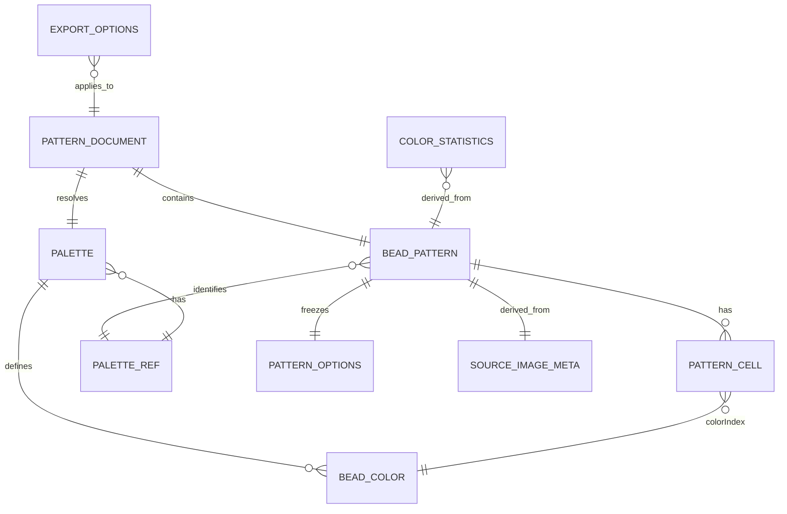

# 拼豆图纸生成工具：核心数据模型（P03）

| 项目 | 内容 |
| --- | --- |
| 文档版本 | v1.0 |
| 日期 | 2026-11-06 |
| 阶段 | P03 技术设计，不包含业务编码 |
| 关联文档 | `docs/architecture.md`、`docs/algorithm-design.md`、`docs/requirements.md` FR-07/FR-09/FR-10 |
| 状态 | 设计基线；实现时以类型和运行时校验同时约束 |

## 1. 建模原则

1. **格子是图纸的唯一真相**：颜色数量、图例、导出都从格子和色盘派生，不保存可与格子分叉的数量矩阵。
2. **空位不是颜色**：空位用 `null` 表示，不占用色盘索引，也不以白色色号代替。
3. **色号索引而非重复字符串**：格子保存 `palette.colors` 的 0-based 索引；官方色号/名称通过不可变色盘快照解析，避免每个格子重复存 code 后发生漂移。
4. **色盘可追溯**：色盘有稳定 `id`、版本、官方来源和校验和；恢复或品牌重映射时必须匹配版本。
5. **参数与结果分开**：`draftOptions` 是尚未生成的界面参数；`BeadPattern.options` 是这张图纸实际使用的冻结参数，不能被界面草稿覆盖。
6. **版本可快照**：任何生成、编辑或重映射产生新的 `stateVersion`；导出锁定版本，不混入后续操作。
7. **持久化安全**：模型只用 JSON 可表达的类型；`Map`、`Set`、`ImageData` 和 Canvas 对象只作为运行时缓存，不进入工程文件。

## 2. 类型总览

```ts
export type Rgb8 = readonly [red: number, green: number, blue: number];
export type Lab = readonly [lightness: number, a: number, b: number];
export type MatcherId = 'rgb-euclidean' | 'cie76' | 'ciede2000';
export type SamplingMode = 'nearest' | 'area';
export type FitMode = 'contain';
export type CellOrigin = 'auto' | 'manual';
export type DitheringMode = 'none' | 'floyd-steinberg';
```

`Rgb8` 的三个分量均为 0-255 的 sRGB 字节；`Lab` 使用 D65 白点和 CIELAB 的 `L*`、`a*`、`b*` 单位。`Lab` 只作为计算缓存或在调试输出中出现，不作为色盘文件的主存储字段。

## 3. BeadColor

```ts
export interface ColorSourceRef {
  documentId: string;
  page: number;
  row?: number;
  column?: number;
}

export interface BeadColor {
  /** 官方色卡编号，如 "18"；同一色盘内唯一。 */
  code: string;
  /** 官方英文名；D-02 规定它是核验和导出的主名称。 */
  officialName: string;
  /** 由官方色卡色块采样的参考 sRGB，不是官方 RGB 标准。 */
  displayRgb: Rgb8;
  /** 该颜色在官方来源中的位置，用于复采样与审计。 */
  source: ColorSourceRef;
  /** 可选中文辅助译名；状态固定为 editorial，不能冒充官方。 */
  translation?: {
    zh: string;
    status: 'editorial';
  };
}
```

职责：

- 表示一个可购买、可核验的实体拼豆颜色。
- `code` 是官方业务标识；`officialName` 是核验标识；`displayRgb` 仅用于屏幕预览和颜色距离计算。
- 不包含 `count`、`selected`、`isUsed` 等派生/界面状态。
- 不包含“相近色合并”字段；相近颜色不得合并为一个色号。

约束：

- `code` 在同一 `Palette` 内唯一且非空。
- `officialName` 非空；中文译名若存在必须标注 `editorial`。
- `displayRgb` 每个分量是 0-255 的整数。
- `source` 能定位到官方文档的页/行/列或等价位置。

## 4. Palette

```ts
export interface PaletteRef {
  /** 稳定色盘 id，如 "hama-midi-solid"；不是品牌广告名。 */
  id: string;
  /** 品牌标识，P0 为 "HAMA"；不表示已支持其他品牌。 */
  brand: string;
  /** 系列，如 "MIDI"。 */
  series: string;
  /** 子系列/变体，如 "SOLID"。 */
  variant: string;
  /** 数据版本，如 "2026"。 */
  version: string;
  /** 色盘 JSON 规范化后的 SHA-256；用于防止同版本换内容。 */
  checksum: string;
}

export interface PaletteSource {
  officialPageUrl: string;
  documentUrl: string;
  documentSha256: string;
  accessedAt: string;
  samplingMethod: string;
  /** 官方色卡是权威来源，但 RGB 仍是派生的参考色，不是厂商标准值。 */
  colorDataSource: 'official-chart-derived';
}

export interface PaletteVerification {
  status: 'verified';
  verifiedAt: string;
  notes: string;
}

export interface Palette {
  ref: PaletteRef;
  colors: readonly BeadColor[];
  source: PaletteSource;
  verification: PaletteVerification;
}
```

职责：

- 描述一个完整的真实品牌色盘快照。
- 提供按索引访问颜色的唯一数组；索引就是格子里的 `colorIndex`。
- 提供来源与验证状态，支撑页面和导出图的真实性说明。
- 不包含运行时 `Map`、Lab 缓存或 UI 选择状态；这些由 `ResolvedPalette` 适配层派生。

约束：

- P0 的 `colors.length` 必须为 67。
- 品牌/系列/版本/校验和必须与官方来源记录一致。
- 同一色号的官方英文名和参考 RGB 不得在运行中变化。
- 版本相同但 checksum 不同，必须视为不兼容，不能静默替换。

运行时代理（不序列化）：

```ts
export interface ResolvedPalette {
  palette: Palette;
  colors: readonly BeadColor[];
  labByIndex: readonly Lab[];
  indexByCode: ReadonlyMap<string, number>;
}
```

`ResolvedPalette` 只用于加速查找；它不是第二份业务数据源，必须由 `Palette` 一次性派生。

## 5. PatternOptions

```ts
export interface PatternOptions {
  targetWidth: number;
  targetHeight: number;
  fitMode: FitMode;
  samplingMode: SamplingMode;
  /** A < alphaThreshold 为空；P0 固定 128。 */
  alphaThreshold: number;
  /** P0 固定白色 [255,255,255]，用于半透明合成。 */
  backgroundColor: Rgb8;
  colorStrategy: {
    matcher: MatcherId;
    dithering: DitheringMode;
  };
}
```

职责：

- 记录“从源图生成这张图纸”所用的全部可复现参数。
- 作为生成请求的一部分，也作为 `BeadPattern` 的冻结元数据。
- 不包含文件名、UI 当前选中的颜色、缩放或导出状态。

P0 允许值：

| 字段 | P0 | P1 | P2 |
| --- | --- | --- | --- |
| `targetWidth/Height` | 32/48/64 预设 | 8-128，总格数 ≤ 16,384 | 可分板尺寸另行评估 |
| `fitMode` | `contain` | 保持 | 可能研究其他模式，不默认裁切 |
| `samplingMode` | `nearest` | 增加 `area` | 保持 |
| `alphaThreshold` | `128` | 保持 | 如变更需版本化 |
| `backgroundColor` | `[255,255,255]` | 保持 | 可研究透明/自定义背景但不得混淆空位 |
| `colorStrategy.matcher` | `cie76` | 保持 | 可增加 `ciede2000` 策略 |
| `colorStrategy.dithering` | `none` | `none` | 显式 `floyd-steinberg` 实验 |

运行时校验器必须拒绝 P0 不支持的组合，而不是依赖 TypeScript 类型自动保证。

## 6. PatternCell 与 BeadPattern

```ts
export interface PatternCell {
  /** 指向 Palette.colors 的 0-based 索引。 */
  colorIndex: number;
  /** 白底合成后的源色；auto 格必须存在，空位转手工色时可为 null。 */
  sourceRgb: Rgb8 | null;
  /** auto 表示生成器匹配；manual 表示用户编辑过。 */
  origin: CellOrigin;
}

export interface SourceImageMeta {
  /** 本次加载的会话内标识，用于判断源图是否被替换。 */
  sourceId: string;
  fileName: string;
  mimeType: string;
  byteSize: number;
  width: number;
  height: number;
  transparentPixelRatio: number;
  orientationApplied: boolean;
}

export interface BeadPattern {
  schemaVersion: 1;
  width: number;
  height: number;
  /** 行优先：index = row * width + column；null = 空位。 */
  cells: readonly (PatternCell | null)[];
  /** 当前品牌/系列/版本的稳定引用。 */
  paletteRef: PaletteRef;
  /** 生成时的冻结参数。 */
  options: PatternOptions;
  source: SourceImageMeta;
  metadata: {
    createdAt: string;
    /** 只在同一图纸内单调递增；编辑、重映射都会产生新值。 */
    stateVersion: number;
    /** 生成设置 + 源图 + 色盘 + 算法版本的规范化摘要。 */
    generationKey: string;
    engineVersion: string;
  };
}
```

关键语义：

- `width × height === cells.length`。
- 行、列均从 0 开始；导出的可见行号可以显示为 1-based，但模型内不混用。
- `cells[i] === null` 就是空位；颜色索引没有 `-1` 哨兵。
- `colorIndex` 必须满足 `0 <= colorIndex < palette.colors.length`。
- `origin === 'auto'` 时 `sourceRgb` 必须非空；`origin === 'manual'` 且由空位转色时允许 `sourceRgb === null`。
- `paletteRef` 必须与当前解析出的 `Palette.ref` 完全相等，包括 checksum。
- `stateVersion` 不是时间戳，不要求跨图纸单调；它用于同一图纸的快照比较。
- `generationKey` 不替代 `stateVersion`：前者判断“参数是否同一代”，后者判断“编辑后是否同一张图”。

### 6.1 为什么不在每格重复保存 paletteCode

需求要求每个有效格可追溯到官方色号。实现上保存 `colorIndex`，渲染、统计和导出时通过 `palette.colors[colorIndex].code` 解析：

- 避免索引与字符串两份数据在编辑、重映射、恢复后漂移；
- 色盘版本和 checksum 锁定了索引含义；
- 导出和测试仍逐格验证 code 存在，满足 AC-12/AC-17/AC-22；
- 工程文件包含色盘快照或可解析的版本，不能只给一个孤立索引。

如果未来需要做跨色盘迁移，迁移函数负责把索引重新绑定到目标 `Palette`，不修改旧图的 `paletteRef`。

## 7. PatternDocument：运行时唯一读模型

```ts
export interface PatternDocument {
  pattern: BeadPattern;
  palette: Palette;
}
```

职责：

- 将“格子索引”和“不可变色盘”绑定为一个可渲染、可统计、可导出的读模型。
- 它是预览、编辑、统计、导出的唯一业务输入；不是第三个独立图纸副本。
- `document.palette.ref` 必须等于 `document.pattern.paletteRef`，否则视为数据损坏。

数据流：

```text
GenerationRequest
  -> SamplingEngine
  -> ColorMatcher + Palette
  -> BeadPattern
  -> PatternDocument(pattern, palette)
  -> Statistics / RenderScene / Export
```

`PatternDocument` 本身可以整体替换；不要在导出过程中原地修改 `pattern.cells`。

## 8. ColorStatistics

```ts
export interface ColorCount {
  colorIndex: number;
  code: string;
  officialName: string;
  displayRgb: Rgb8;
  count: number;
}

export interface ColorStatistics {
  patternStateVersion: number;
  paletteChecksum: string;
  width: number;
  height: number;
  totalCells: number;
  beadCount: number;
  emptyCount: number;
  usedColorCount: number;
  colors: readonly ColorCount[];
}
```

职责与规则：

- 只统计非空 `PatternCell`；空位计入 `emptyCount`，不计入 `beadCount` 或逐色数量。
- `beadCount + emptyCount === totalCells === width * height`。
- `colors` 只包含 count > 0 的色号；按数量降序，数量相同按官方 code 升序。
- `usedColorCount === colors.length`。
- `patternStateVersion` 与 `paletteChecksum` 必须与输入文档一致；不一致的统计视为过期，UI 不得展示。
- 统计是派生结果，不进入 `BeadPattern`，不维护独立增量缓存作为真相。

## 9. ExportOptions 与 ExportResult

```ts
export type ExportFormat = 'png'; // P2 再扩展 'pdf' | 'svg'

export interface ExportOptions {
  format: ExportFormat;
  /** 导出图每格边长；P0 必须 >= 40。 */
  cellSizePx: number;
  marginPx: number;
  majorGridEvery: 5 | 10;
  title?: string;
  includeCodes: true;
  includeCoordinates: true;
  includeLegend: true;
  includePaletteSource: true;
  /** 有 ColorStatistics 时才可开启；P0 不强制逐色数量。 */
  includeColorCounts: boolean;
  maxOutputPixels: number;
  maxOutputSidePx: number;
}

export interface ExportResult {
  blob: Blob;
  fileName: string;
  widthPx: number;
  heightPx: number;
  stateVersion: number;
  format: ExportFormat;
}
```

规则：

- `includeCodes`、`includeCoordinates`、`includeLegend`、`includePaletteSource` 是 P0 不可关闭的强制项；用字面量 `true` 固化。
- `format` 在 P0 只允许 `png`；PDF/SVG 不得伪装成 PNG 导出。
- `ExportOptions` 不保存到图纸模型；它描述一次导出动作。
- 导出结果记录 `stateVersion`，用于发现“导出期间图纸已被修改”。
- 文件名由图纸尺寸、色盘 id/版本和日期生成；不依赖用户输入的任意路径。

## 10. 运行时辅助类型

这些类型不持久化，但应在接口中明确，避免 UI 直接处理浏览器对象：

```ts
export interface RgbaImage {
  width: number;
  height: number;
  /** RGBA 字节，长度为 width * height * 4；alpha 为非预乘。 */
  data: Uint8ClampedArray;
}

export interface DecodedImage {
  image: RgbaImage;
  meta: SourceImageMeta;
  release(): void;
}

export interface GenerationRequest {
  image: RgbaImage;
  source: SourceImageMeta;
  palette: Palette;
  options: PatternOptions;
}
```

`RgbaImage` 是算法输入，不进入 `BeadPattern`；它避免领域层直接依赖 DOM 的 `ImageData` 类型。

## 11. P1 工程文件（本地 JSON）

```ts
export interface PatternProjectFile {
  fileSchemaVersion: 1;
  pattern: BeadPattern;
  /** 与 pattern 分离的色盘快照，便于离线恢复而不复制到每格。 */
  paletteSnapshot?: Palette;
  savedAt: string;
  appVersion: string;
}
```

设计理由：

- 满足 FR-12“含色盘版本但与色盘数据分离”：版本和 checksum 在 `pattern.paletteRef`，完整色盘是独立顶层字段。
- 恢复时先校验 `pattern.paletteRef` 与快照/内置色盘；版本不匹配时提示“使用旧快照”或“重新匹配”，不能静默换色。
- 不把原始图片二进制塞入 JSON 作为 P1 默认；编辑和导出只需要格子与 `sourceRgb`，重新改变尺寸时才要求用户重新选择原图或另做工程迁移。
- 不恢复 `stateVersion` 以外的 UI 选择、缩放、抽屉状态。

## 12. 实体关系



`PATTERN_CELL` 为空位时没有 `BEAD_COLOR` 关联；这是模型中的合法状态，不是缺失数据。

## 13. 不变量与校验清单

启动色盘校验：

- P0 恰好 67 个条目；code 唯一、name 非空、RGB 合法。
- 每条有来源位置；文档哈希和访问日期存在。
- 规范化 JSON 的 checksum 与 `PaletteRef.checksum` 一致。
- 任何一条失败则禁止生成和导出，不用“部分可用”继续。

图纸校验：

- 尺寸为正整数；P0 为 32/48/64；P1 满足 8-128 且总格数 ≤ 16,384。
- `cells.length === width * height`。
- 每个非空 cell 的 `colorIndex` 在范围内。
- 每个 auto cell 有非空 `sourceRgb`；空位是 `null`。
- `paletteRef` 与已解析色盘一致。
- `stateVersion` 为正整数；编辑后严格递增。
- `options` 的所有 P0 字段是允许值。

统计校验：

- 逐格遍历计数与 `ColorStatistics.colors` 一致。
- `beadCount + emptyCount === totalCells`。
- 统计的 `patternStateVersion` 等于当前图纸版本。

导出校验：

- `includeCodes/includeCoordinates/includeLegend/includePaletteSource` 均为 true。
- 输出像素预算没有超限。
- 导出开始后读取的 `PatternDocument` 引用不再变化。
- `ExportResult.stateVersion` 等于导出开始时捕获的版本。

## 14. 需求映射

| 数据设计 | 需求/验收 |
| --- | --- |
| `PatternCell = null` 空位 | FR-03、AC-04、AC-13 |
| `colorIndex → BeadColor.code` | FR-06、FR-07、AC-12、AC-17 |
| `PatternOptions` 冻结生成参数 | FR-04、FR-07 |
| `paletteRef` 品牌/版本/checksum | FR-05、AC-07、AC-08、AC-09、AC-14 |
| `stateVersion` 快照 | FR-10、AC-22、AC-P1-09 |
| `ColorStatistics` 从 cells 派生 | FR-09、AC-P1-01、AC-P1-08 |
| `sourceRgb` 用于重映射 | FR-16、AC-P2-01 |
| `PatternProjectFile` 本地恢复 | FR-12、AC-P1-05 |

## 15. 明确不做

- 不把颜色矩阵、统计数量和图例各存一份。
- 不用 `-1`、`0` 或白色索引表示空位。
- 不在每个格子重复保存可变的完整 `BeadColor` 对象。
- 不把 Canvas、ImageBitmap、DOM 或 `Map` 直接放进可保存的工程文件。
- 不维护“当前品牌”与“图纸品牌”两个可以各自漂移的字段；以 `pattern.paletteRef` 为准。
