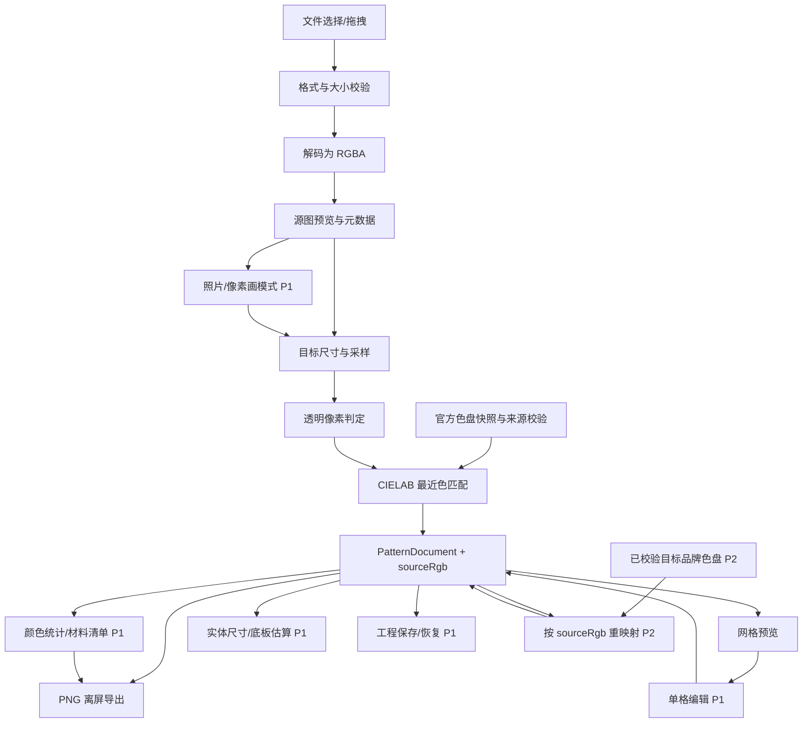

# 拼豆图纸生成工具：需求分析

| 项目 | 内容 |
| --- | --- |
| 文档版本 | v1.1（P02 深化） |
| 日期 | 2026-11-06 |
| 阶段 | 需求深化与用户体验设计（不含业务编码） |
| 交付周期 | 72 小时 |
| 默认品牌 | Hama |
| 默认 P0 导出格式 | PNG |
| 需求依据 | 用户提供的原始题目、Hama 官方公开色卡 |
| 确认状态 | 品牌、P0 尺寸口径、PNG 导出、透明阈值已于 2026-11-06 确认 |

## 0. 阅读约定

本文对每条结论标注来源，避免把推断混入原题：

- **【原题】**：题目明确要求，不能删减、降级或改成可选。
- **【工程推断】**：为了实现原题而必须补齐的工程规则，可调整，但调整后必须仍满足原题。
- **【待确认】**：当前没有唯一答案，本文给出默认决策，确认后再冻结。
- **P0 / P1 / P2**：P0 是交付底线；P1 是强价值增强；P2 是时间允许再做。

“必须”表示 P0 验收项；“应”表示 P0 的实现质量要求；“可”表示 P1/P2。

### 0.1 已确认基线

以下决策不再是待确认项，作为本轮设计与后续实现的冻结基线：

| 编号 | 已确认决策 | 影响 |
| --- | --- | --- |
| C-01 | 首发品牌为 Hama，使用官方 2026 Midi Solid 67 色 | 不实现品牌切换即满足 P0；多品牌为 P2 |
| C-02 | P0 目标尺寸采用 32/48/64 预设，P0 导出 PNG | 自定义尺寸列为 P1，PDF 列为 P2 |
| C-03 | `A<128` 为空位；`A>=128` 先合成白底再匹配 | 透明区域不得自动变成白色豆 |

P02 的深化不得删除、弱化或把上述之外的任何原题 P0 要求转为可选。本文新增的照片友好处理、实体尺寸、分板、品牌重映射、单格编辑等均明确标注为 P1/P2。

## 1. 项目目标与范围

### 1.1 目标

用户上传一张像素图片，选择目标图纸尺寸，系统读取图片像素，将有效像素映射到真实 Hama 拼豆色盘，生成带逐格色号、网格线和图例的拼豆图纸，并可在浏览器中下载为可独立阅读的 PNG。

完整业务闭环是：

`上传图片 -> 解码并读取像素 -> 目标尺寸采样 -> 透明像素判定 -> 实体色盘匹配 -> 图纸预览 -> PNG 下载`

### 1.2 产品边界

- 本工具是“图纸生成器”，不是在线商店、库存系统、图片编辑器或 3D 预览器。
- P0 使用纯前端本地处理，不上传原图或生成结果到服务器。
- P0 只承诺一个品牌的实色基础盘；多品牌、特殊效果豆、色盘自选为 P2。
- 显示 RGB 是从官方色卡采样得到的参考值，不宣称是厂商发布的屏幕标准 RGB。最终选豆仍以官方色号和实物色卡为准。

### 1.3 成功标准

用户无需理解颜色算法，也不需要手工数格：下载的图纸在脱离网页后，仍能按格子位置、网格线、色号和图例还原制作过程；每个有豆格子都能追溯到真实品牌颜色编号。

## 2. 原题需求拆分

### 2.1 强制需求（P0）

| 编号 | 强制需求 | 原题落点 | 追踪章节 |
| --- | --- | --- | --- |
| M1 | 支持上传像素图片 | 1. 图片上传与处理 | FR-01 |
| M2 | 能读取图片像素颜色 | 1. 图片上传与处理 | FR-02 |
| M3 | 能按目标图纸尺寸采样和处理 | 1. 图片上传与处理 | FR-03、FR-04 |
| M4 | 提供真实存在品牌的真实色盘 | 2. 真实品牌色盘匹配 | FR-05 |
| M5 | 至少一个品牌的基础色盘 | 2. 真实品牌色盘匹配 | FR-05 |
| M6 | 色盘包含可核验色号及颜色数据 | 2. 真实品牌色盘匹配 | FR-05 |
| M7 | 图片像素映射到最接近的实体豆颜色 | 2. 真实品牌色盘匹配 | FR-06 |
| M8 | 每个有效像素对应实际色盘颜色及色号 | 2. 真实品牌色盘匹配 | FR-06、FR-07 |
| M9 | 不编造品牌、色号或官方数据，记录来源和准确性说明 | 2. 真实品牌色盘匹配 | FR-05、NFR-05 |
| M10 | 根据匹配结果生成拼豆网格图纸 | 3. 拼豆图纸生成 | FR-07、FR-08 |
| M11 | 图纸有清晰网格线 | 3. 拼豆图纸生成 | FR-08 |
| M12 | 每个网格能标记对应色号 | 3. 拼豆图纸生成 | FR-08 |
| M13 | 图纸具有足够可读性 | 3. 拼豆图纸生成 | FR-08、AC-18、AC-19 |
| M14 | 支持图纸下载 | 4. 图纸下载与导出 | FR-10 |
| M15 | 至少支持 PNG 或 PDF 一种 | 4. 图纸下载与导出 | FR-10 |
| M16 | 导出结果包含网格线和色号 | 4. 图纸下载与导出 | FR-10 |
| M17 | 导出文件可独立阅读，不依赖网页 | 4. 图纸下载与导出 | FR-10、AC-23 |

### 2.2 进阶需求（P1/P2）

| 编号 | 能力 | 初始优先级 | 用户价值 | 说明 |
| --- | --- | --- | --- | --- |
| A1 | 色号用量统计 | P1 | 采购与备豆 | 由已生成网格直接聚合，成本低 |
| A2 | 材料采购清单 | P1 | 一次性买齐 | 依赖 A1，可按色号、名称、数量列示 |
| A3 | 完整自定义宽高 | P1 | 适配实际底板 | 原题 P0 只需有目标尺寸选择 |
| A4 | 单格颜色编辑 | P1 | 修正错配 | 高价值，但需编辑状态和重绘 |
| A5 | 撤销 / 重做 | P1 | 编辑安全感 | 与 A4 配套，不做 A4 则不做 A5 |
| A6 | 工程保存与恢复 | P1/P2 | 中断后继续 | JSON 工程文件优先于账号云存储 |
| A7 | 大型图纸自动分板 | P2 | 大型作品可制作 | 依赖尺寸、分板规则和分页导出 |
| A8 | PDF / SVG 导出 | P2 | 更高打印质量 | P0 已有 PNG，非强制 |
| A9 | 多品牌色盘 | P2 | 采购偏好 | 每个品牌都需独立来源与校验 |
| A10 | 限制用色数 / 抖动 | P2 | 更像手工设计 | 会改变“最接近”的直接映射口径 |
| A11 | 照片友好采样 | P1 | 普通照片也能得到可制作结果 | 与“像素画最近邻”分开，需用户可见地切换 |
| A12 | 实体尺寸与底板估算 | P1 | 知道成品多大、需要几块板 | 只做估算与提示，不自动分板 |
| A13 | 品牌色盘重映射 | P2 | 用户换品牌后继续制作 | 必须从源色重新匹配，不能直接翻译色号 |
| A14 | 色彩匹配策略切换 | P2 | 控制简化程度与风格 | CIE76/CIEDE2000/限色并非同一种改动 |

## 3. 强制需求用户故事

| 故事编号 | 用户故事 | 对应需求 |
| --- | --- | --- |
| US-01 | 作为拼豆爱好者，我希望上传一张像素图并立即看到原图预览，以确认文件没有传错。 | M1、M2 |
| US-02 | 作为制作者，我希望选择目标图纸尺寸，让成品适配我的底板和珠量预算。 | M3 |
| US-03 | 作为制作者，我希望透明背景保持为空位，而不是被强行换成白色豆。 | M3、M8 |
| US-04 | 作为消费者，我希望每个有豆格子都对应真实 Hama 色号和颜色，以便按编号购买和摆放。 | M4-M9 |
| US-05 | 作为制作者，我希望看到带网格、行列定位和逐格色号的图纸，并能放大检查。 | M10-M13 |
| US-06 | 作为制作者，我希望下载一张包含网格、色号和图例的 PNG，在没有网络时也能照着做。 | M14-M17 |
| US-07 | 作为谨慎的用户，我希望看到色盘来源、采样方式和颜色差异说明，以判断数据可信度。 | M9 |

### 3.1 P1/P2 用户故事

| 故事编号 | 用户故事 | 优先级 | 对应能力 |
| --- | --- | --- | --- |
| US-P1-01 | 作为采购者，我希望按色号看到每种豆的数量，并能导出采购清单。 | P1 | A1、A2 |
| US-P1-02 | 作为制作者，我希望知道成品大约多少厘米、至少需要几块底板。 | P1 | A3、A12 |
| US-P1-03 | 作为普通照片用户，我希望系统明确告诉我照片会失真，并提供更平滑的采样方式。 | P1 | A11 |
| US-P1-04 | 作为制作者，我希望手动修正个别格子，并看到清单和导出同步变化。 | P1 | A4、A5 |
| US-P2-01 | 作为换品牌的用户，我希望用原图重新匹配新色盘，而不是把 Hama 色号硬翻成对方色号。 | P2 | A9、A13 |
| US-P2-02 | 作为大图用户，我希望分板图纸能告诉我在第几块板、第几行第几列放置。 | P2 | A7 |
| US-P2-03 | 作为进阶用户，我希望在“最接近”与“限色/风格化”之间明确切换，并知道结果差异。 | P2 | A10、A14 |

## 4. 功能需求与输入、处理、输出

### FR-01 图片选择与上传

**输入**

- 用户通过文件选择器或拖拽提供 1 个图片文件。
- P0 至少支持 PNG；同时支持浏览器原生可解码的 JPEG、WebP。
- 单文件上限 20 MB，源图上限 16,777,216 像素（约 4096×4096）。【工程推断】

**处理**

1. 校验文件存在、大小和 MIME/解码能力。
2. 对文件名做安全展示，不使用文件名拼接 DOM HTML。
3. 读取文件为 ArrayBuffer/Blob，不发送到服务器。
4. 解码为位图；应用 EXIF 方向；动画图只取首帧并提示。
5. 记录文件名、原始宽高、格式和解码告警，不记录不必要的隐私信息。

**输出**

- 标准化的 RGBA 像素缓冲和源图元数据。
- 成功：显示原图预览、源图尺寸和继续操作入口。
- 失败：明确区分“不支持格式 / 文件损坏 / 文件过大 / 解码失败”，不进入生成流程。

### FR-02 像素读取

**输入**：标准化 RGBA 位图。

**处理**：按 sRGB 8 位通道读取 R、G、B、A；不做仅依赖 CSS 的视觉取色。浏览器色彩管理导致的结果差异需在准确性说明中披露。

**输出**：可被采样器读取的 RGBA 数据；每个源像素保留透明度。

### FR-03 透明与有效像素判定

**输入**：采样后的目标格 RGBA。

**处理**

- `A < 128`：该格为空位（不放豆），不参与色盘匹配。
- `A >= 128`：该格为有效像素，先按 `source * A + white * (1 - A)` 合成到白色背景，再参与匹配。
- 缩放必须使用预乘 alpha，避免透明区域的 RGB 污染边缘。
- 若全图最终没有任何有效格，阻止生成并提示用户。

**输出**：每格状态为 `empty` 或 `bead`；有效格带有不透明 RGB。

**说明**：这是 P0 固定规则；允许用户调整阈值或背景色属于 P2。界面必须披露该规则，防止半透明边缘产生意外结果。

### FR-04 目标尺寸与图片采样

**输入**：源 RGBA 位图、目标宽 `W`、目标高 `H`。

**处理**

- P0 提供至少 32×32、48×48、64×64 三个预设，默认 64×64。
- P1 允许自定义 8-128 的宽高，单张最多 16,384 格。
- 默认采用“完整包含（contain）”：保持原始宽高比，内容居中，剩余格为空。P1 可增加“拉伸填满”和“裁切填满”。
- 默认采用最近邻采样以保留像素画的硬边；P1 可增加区域平均采样用于非像素画或大幅缩小。
- P0 对普通照片仍必须安全处理并显示质量告警，但只承诺最近邻路径；P1 增加明确的“像素画/照片”采样模式，不得让用户误以为普通照片会自动变成低色数插画。
- 每个目标格映射到源图对应区域的采样结果；缩放时同时重采样 alpha。

**输出**：尺寸恰为 `W × H` 的目标格矩阵，包含 RGBA 与空位信息。

### FR-05 品牌色盘装载与真实性

**输入**：随应用发布的、经过人工核验的 Hama 色盘快照。

**处理**

1. 启动时一次性装载，不从不明第三方接口实时抓取。
2. 校验色盘版本、唯一色号、颜色值格式、来源 URL、官方色卡页码/版次和校验和。
3. P0 使用 **Hama 官方 2026 年 Midi Colour palette 中 Solid 页的 67 色基础实色盘**（PDF 第 1 页；左下角 `34` 是页码，不是颜色数量）。
4. 每个条目至少包含：
   - `paletteId`、`brand: HAMA`、`series: Midi`
   - `code`：官方色卡上的 2-3 位编号，如 `18`
   - `name`：官方色卡英文名，如 `Black`
   - `displayRgb`：由官方色卡色块采样得到的参考 sRGB 值
   - `sourceUrl`、`sourceDocument`、`sourcePage`、`accessedAt`
   - `colorDataSource: official-chart-derived`，明确它不是官方 RGB 标准
   - `verificationStatus: verified`
5. 不允许把特殊效果豆（透明、夜光、Bio 等）混入 P0 实色基础盘，除非单独分组。
6. 色盘颜色值在代码中只能作为数据存在，不能由界面临时生成或人工随意补色。

**输出**：不可变的调色板对象、按色号索引的查询表、可展示给用户的来源说明。

**官方来源（2026-11-06 检索）**

- 官方色卡页：<https://hama.dk/en/pages/colour-chart>
- 官方 Midi 色盘 PDF：<https://cdn.shopify.com/s/files/1/0726/3771/0492/files/Midi_-_Colour_palette.pdf?v=1777369953>
- 官方数字色卡 PDF：<https://cdn.shopify.com/s/files/1/0726/3771/0492/files/colour-chart-number.pdf?v=1777215620>
- 检索时 Midi 色盘 PDF 的 SHA-256：`6AC736AA546ADEC53DF5F82AEE900F190A79530FF8F2C796723F430AB40FA6F4`
- 检索时数字色卡 PDF 的 SHA-256：`9AA7344AE09710CD15127EF1FC5ED217077344E2E8797BC69C084D9FF63C82FA`

**数量核对**：官方 Midi 色盘 PDF 第 1 页为 `Solid` 实色页，共 8 行，逐行色块数为 9、9、8、8、9、7、9、8，合计 **67 色**；页脚左下角的红色 `34` 是页码，不是颜色数量。实现时仍需逐项核对全部 67 个色号与英文名。

**数据准确性声明**

- 官方来源确认的是品牌、系列、色号和颜色名称。
- `displayRgb` 是将官方 PDF 色块按固定流程转为屏幕色后取得的采样值；它不是 Hama 官方发布的 sRGB 定义。必须标注“参考色，受屏幕、打印、材料批次和光线影响”。
- 取色必须记录方法：渲染/取样倍率、每个色块多个豆面区域的取样坐标、取中位值或平均值、避开高光/阴影/背景/文字和描边。官方 PDF 使用商品照片而非平面色块，因此必须明确这是“照片派生参考色”。实现时把取样坐标和版本固定，保证可重复。
- 不把网店照片、论坛表格或个人自制色卡当作官方数据；如用于交叉参考，只能标为辅助验证。

**品牌切换约束（P2）**

- P0 只提供 Hama，不显示可用的“Perler/Artkal”假选项。
- P2 更换品牌时，必须用每格保存的源色重新匹配新品牌色盘，不能把 Hama 色号按名称/编号直接翻译成另一品牌色号。
- 新色盘必须单独通过来源、色号、颜色采样和版本校验；没有第二品牌数据包时，切换入口必须禁用并解释原因。

### FR-06 颜色匹配

**输入**：有效目标格的不透明 sRGB 值、Hama 67 色色盘。

**处理**

1. 将 sRGB 转线性 RGB，再转 D65 XYZ、CIELAB。
2. 对每个有效格计算与全部色盘颜色的 CIE76 `ΔE*ab` 距离，选择最小值。
3. 距离相同时按官方色号字典序升序取第一个，保证结果稳定。
4. 匹配结果必须保存 `palette code`，不能只保存 RGB。
5. P0 不做抖动、不限制颜色数量；所有 67 色均参与匹配。
6. 若色盘数据缺失或校验失败，禁止生成，不能退回伪造的“近邻颜色表”。

**输出**：每个有效格的 `{ paletteCode, paletteId, distance }`；空位为 `null`。

**可验证性**

- 使用色盘中的精确 `displayRgb` 自测时，每个颜色必须匹配回自身。
- 纯黑、纯白等基准色应落到对应的最深/最浅色号；最终期望值以冻结后的色盘为准。

### FR-07 图纸模型

**输入**：目标格矩阵、匹配结果、色盘版本。

**处理**：构建不可变或可版本化的图纸状态；保存尺寸、空位、每格色号、色盘版本和生成设置。P0 预览与导出必须读取同一份状态，避免预览和下载不一致。

**输出**：`PatternDocument`，至少包含：

```text
schemaVersion
pattern: {
  width,
  height,
  cells: Array<null | {
    sourceRgb: [r, g, b],
    paletteCode,
    origin: "auto" | "manual"
  }>
}
palette: { id, brand, series, version, source }
settings: { targetWidth, targetHeight, fitMode, samplingMode, alphaThreshold, background }
metadata: { createdAt, sourceName, sourceDimensions, stateVersion }
```

`sourceRgb` 是该格合成白底后的采样色，用于 P2 品牌重映射；P0 也必须保存它，不能只留下 Hama 色号。颜色用量是由 `cells` 派生的结果，不作为独立真相来源。

### FR-08 网格图纸渲染

**输入**：`PatternDocument`、视口缩放和导出参数。

**处理**

- 每格填充该色号的 `displayRgb`；空位使用区别于豆色的底色/纹理。
- 每格绘制清晰边界线；每 5 格或 10 格加粗主网格线。
- 每个有豆格在格内绘制官方色号；按格宽自适应字号，不能裁切或重叠。
- 文字使用黑/白高对比色并加细描边，保证深色和浅色豆上都可读。
- 提供行、列编号，建议每 5 格标注一次，便于定位。
- 图例至少列出：色块、官方色号、官方名称；包含总格数、有效豆数、空位数。
- 预览支持缩放/滚动；缩放到过小时，不应让用户误以为图纸没有色号，导出仍必须完整带号。

**输出**：屏幕 Canvas/SVG 预览，以及与预览同源的导出绘制指令。

### FR-09 颜色用量统计与材料清单（P1；基础图例在 P0）

**输入**：`PatternDocument`。

**处理**：只统计有效格；按色号聚合数量；材料清单按色号排序，显示色号、名称、数量。数量必须由当前 `cells` 派生或可验证地增量更新；提供“实际需要”和可选的备豆余量，但备豆建议必须与硬性数量分列。不得把某品牌的包装规格当作官方库存承诺。

**输出**：总用豆数、各色号数量、导出图例中的采购清单。P1 不改变 P0 的匹配结果。

### FR-10 PNG 图纸导出

**输入**：当前 `PatternDocument`。

**处理**

1. 使用离屏 Canvas 按固定导出比例重绘，不复用屏幕上被缩放/裁切的预览。
2. 每格至少 40×40 导出像素；网格线至少 1 px，主网格线至少 2 px。
3. 导出图包含完整网格、每格色号、行列编号、图例、标题、图纸尺寸、总豆数、色盘来源和生成时间。
4. 图例中每个颜色带官方色号、名称、色块；若实现 FR-09，则带数量。
5. 使用本地 Blob 下载 `image/png`，不依赖服务端；失败时给出可操作错误。
6. 导出内容必须与当前图纸状态一致；不得只截取屏幕可见区域。
7. 预览与导出必须调用同一个渲染核（共享布局、色号绘制、图例和空位规则）；导出时捕获不可变 `stateVersion` 快照，导出过程中发生编辑也不能混入半新半旧状态。

**输出**：可独立打开的 `.png` 文件；尺寸至少覆盖全部格子与图例，文件名包含宽高和色盘标识。

### FR-11 单格编辑与撤销/重做（P1）

**输入**：用户点击的格子、选择的新色号或“空位”。

**处理**：修改当前图纸状态；将格标记为 `origin=manual`；重绘预览，并从 `cells` 重新计算颜色数量、总数和材料清单；将编辑操作（旧值/新值、旧数量/新数量）压入撤销栈；撤销/重做恢复状态与统计。P0 图纸模型应为该能力预留“状态可替换”的结构，但不在 P0 验收范围。

**输出**：更新后的网格、用量统计和导出结果。

### FR-12 工程保存与恢复（P1/P2）

**输入**：当前 `PatternDocument` 或本地工程文件。

**处理**：导出 JSON（含色盘版本但与色盘数据分离）；恢复时校验 schema 和色盘版本，缺失/升级时提示而不是静默换色。

**输出**：可重新打开的工程文件；P0 不要求。

### FR-13 大型图纸分板（P2）

**输入**：超出一个物理底板的图纸尺寸、单板规格。

**处理**：按单板行列切分，保留板间重叠/坐标标记；分板导出时可生成多个 PNG 或一个分页 PDF。

**输出**：带板号、全局坐标和重叠提示的分板图纸。P0 不要求；P0 通过尺寸上限避免被迫分板。

### FR-14 实体尺寸与底板适配（P1）

**输入**：图纸宽高（格）、品牌系列的每格中心距、可选底板规格。

**处理**

- 默认以 Hama Midi 常见约 5 mm 中心距给出估算，并在 UI 标注“估算值，实际以底板为准，可修改”。
- 成品尺寸公式：`宽_mm = 列数 × 每格中心距`，`高_mm = 行数 × 每格中心距`。
- 底板数量理论下限：`ceil(列数 / 单板列数) × ceil(行数 / 单板行数)`；必须提示“未计板间重叠、拼接和设计留白，至少需要”。
- P1 只显示底板数量和可选接缝参考线；真正的分板导出属于 P2。
- 纸张打印尺寸与成品尺寸分开说明：纸张缩放不改变成品珠数，但会改变图纸可读性。

**输出**：格数、估算宽高、所需底板数量、底板规格说明、打印注意提示。

### FR-15 照片友好采样（P1）

**输入**：普通照片、用户选择的“像素画/照片”处理模式。

**处理**

- 上传后展示源图尺寸、透明度、独特颜色数和轻量质量提示；可给出“更像像素画/更像照片/不确定”的建议，但不得强制自动判定。
- 像素画模式：最近邻、硬边保留，P0 默认。
- 照片模式：预乘 alpha 的区域平均缩放；在缩小时保留整体明暗和轮廓，避免最近邻造成细节随机丢失。
- 照片模式不等于自动风格化：不默认抖动、不抠背景、不把人脸变成低色数卡通；这些分别属于 P2。
- 两种模式都必须经过相同的透明判定、实体色匹配、逐格色号化和 PNG 导出；切换后重算并保留可撤销性（若已实现编辑）。

**输出**：带模式标识、告警、预览和重算结果的图纸。

### FR-16 品牌色盘重映射（P2）

**输入**：当前 `PatternDocument` 的每格 `sourceRgb`、目标品牌已校验色盘。

**处理**

1. 逐格从 `sourceRgb` 重新匹配目标色盘。
2. 空位保持空位；`origin=manual` 的格子默认保留并标记“未随品牌切换”，用户可选择“全部重算”。 
3. 显示前后颜色数量差异、颜色损失和来源；一次切换生成新的色盘版本号。
4. 切换可撤销；新导出的图必须写目标品牌、色盘版本和重映射时间。
5. 若目标色盘缺失或未校验，禁止切换，不能拿 Hama 色号冒充目标品牌。

**输出**：目标品牌的新图纸状态、差异摘要、新的材料清单与导出。

### FR-17 色彩匹配策略切换（P2）

**输入**：P0 直接最近色、可选限色/抖动/更精细色差策略。

**处理**

- 默认保持 CIE76 最近色；“限色”“抖动”“CIEDE2000”等均是独立策略，不是一个模糊的“更准”开关。
- 切换前显示策略说明和预计影响；切换后生成新结果，不覆盖原结果直到用户确认。
- 导出必须记录使用的策略、色盘版本和参数，保证图纸可复核。
- P2 不得靠调低色号可读性来表达“艺术效果”；色号仍是生产信息。

**输出**：带策略元数据的重算图纸、差异摘要和可回退入口。

## 5. 功能依赖关系



关键依赖事实：

- 色盘真实性校验必须先于颜色匹配；色盘失败时不能降级到临时 RGB 匹配。
- 目标格采样和透明判定必须先于匹配；否则会把透明格错误地算成黑色或白色豆。
- 照片模式只改变采样质量，不绕过透明判定、实体匹配和逐格色号化。
- 预览和导出必须共用同一个 `PatternDocument` 和渲染核，不能各自重新计算；导出需绑定状态快照。
- 颜色统计必须从最终网格状态派生；若实现单格编辑，统计、图例和导出都必须随状态更新。
- 实体尺寸估算依赖格数和每格中心距，不依赖 PNG 的屏幕像素尺寸；底板数量依赖明确的底板规格。
- 品牌重映射依赖每格 `sourceRgb` 和目标品牌已校验色盘，不能从旧色号直接翻译。
- 分板依赖尺寸、图纸坐标和物理底板规格；不能只做视觉切割而不标板间位置。
- 工程恢复依赖色盘版本；只保存 RGB 会违反“可追溯到真实色号”的要求。

## 6. 边界与异常分析

### 6.1 透明像素

| 情况 | P0 规则 | 原因 |
| --- | --- | --- |
| Alpha = 0 | 空位，不匹配豆色 | 透明背景不应被当成白色豆 |
| Alpha 1-127 | 空位，计入半透明告警 | 低于 50% 不构成可靠有效像素 |
| Alpha 128-254 | 合成到白底后匹配 | 避免把边缘像素直接丢成黑色；结果需在预览中可见 |
| Alpha = 255 | 直接匹配 | 正常不透明像素 |
| 全图无有效像素 | 阻止生成并提示 | 没有可制作内容，导出无意义 |
| 透明区域 RGB 为任意值 | 用预乘 alpha 采样，不参与颜色污染 | 防止透明边缘产生彩边 |

【已确认】白底合成是 MVP 默认；如用户实际需要“透明边缘全丢”或自定义背景，放到 P2 设置项，但不得悄悄改变 P0 口径。

### 6.2 图片格式

- P0 必须支持 PNG。JPEG、WebP 在浏览器可解码时支持；GIF/APNG 仅取首帧并提示。
- 不支持 SVG、HEIC、BMP、TIFF 作为 P0 合同项；应给出不支持提示，不能靠扩展名猜测成功。
- 扩展名与真实内容不一致时，以解码结果为准；解码失败即失败。
- CMYK JPEG、带 ICC 配置文件的图片由浏览器转换；必须提示“屏幕颜色仅为参考”，不能承诺跨设备完全一致。
- EXIF 旋转必须应用，否则用户在手机上拍/存的正方形图会被错误采样。
- 普通照片允许进入流程，但必须提示“非像素画/抗锯齿图会产生噪声和细节损失”；不得无声承诺高质量。

### 6.3 图片尺寸与比例

- 源图极小时允许最近邻放大，但界面提示“源图像素不足，细节会被重复”。
- 源图极大时先校验上限；P0 不静默上传到服务器做缩放。
- 目标尺寸小于源图时，最近邻会丢弃部分像素；这是像素画保边策略的已知代价。
- 目标尺寸宽高比与源图不一致时，contain 模式保留全部内容并留空边；不能未经提示裁切。
- 目标尺寸上限用于保护浏览器内存和色号可读性；P0 预设不触发超限，P1 自定义必须校验 8-128 和总格数。
- 普通照片的细节密度和源图尺寸共同决定可行目标尺寸；用户选得过小时，应提示“细节将被压缩”，但不强制阻止。

### 6.4 色盘真实性

- 品牌、系列、色号、名称必须能在官方来源中复核；任何新增色号必须补来源和校验记录。
- 官方色卡版本升级时，旧工程使用旧色盘快照或提示迁移，不能静默改色号。
- 官方色卡中的“颜色可能因批次/屏幕不同”声明必须保留在数据说明中。
- 透明、夜光、Bio、Mini、Maxi 等系列不得与 Midi Solid 混成一个无标签色盘。
- 色号是业务主键；展示名可翻译，但必须保留官方英文名用于核对。
- 采样颜色必须可重复：固定 PDF 版本、渲染器设置、取样区域和聚合方法。

### 6.5 颜色匹配

- “最接近”定义为 CIELAB 空间中的最小 CIE76 距离；相同距离按官方色号升序稳定决策。
- 匹配是逐格独立计算，不做抖动或区域风格化；P0 的可解释性优先于视觉平滑。
- 色盘外的照片颜色仍会匹配到某个实体色，但结果可能偏差较大；预览必须显示警告“照片/抗锯齿图未必适合拼豆”。
- 灰度图会匹配到黑白灰列，不应因 RGB 欧氏距离的偏差而跳到蓝色或棕色。
- 不能把匹配后的 RGB 再“美化”成另一个近似色；显示色必须来自色盘记录。

### 6.6 图纸与打印可读性

- 图纸可读性不是“有网格线”即可，还必须满足：格子可定位、色号不裁切、图例可追溯、空位可区分、颜色数量可核对。
- 色号字体必须在深色和浅色背景上都有足够对比；不能只用单一黑色文字。
- 导出图固定按足够大的格宽绘制，不能截取屏幕缩略图。
- 颜色本身在不同打印机/屏幕上会有差异，因此色号是主标识，色块只是辅助。
- 大图会触发 Canvas 尺寸和内存限制；P0 通过尺寸上限规避，P1/P2 再处理分板或矢量导出。
- 若 PNG 超过浏览器可创建画布上限，应阻止导出并提示降低尺寸，不能生成半张图。

### 6.7 失败与恢复

- 任何一步失败都必须保留用户已选文件和已生成图纸（若存在），允许重试。
- 色盘加载失败时显示“无法验证实体色盘”，不得继续输出带虚假色号的图纸。
- 下载失败时提供“重新生成”入口；不能只留下无响应的按钮。
- 用户刷新页面后 P0 不保证恢复工程；该能力属于 P1/P2，不能作为 P0 的隐含承诺。

### 6.8 实体尺寸与底板

- 成品尺寸按“格数 × 每格中心距”估算，默认 Hama Midi 约 5 mm/格，必须标注估算误差和可修改性。
- 底板数量按底板规格计算理论下限，不把“至少需要”说成“刚好装下”；拼接重叠和边缘留白会增加用量。
- 纸张打印尺寸与成品尺寸分开显示；用户放大打印 PNG 不会改变珠数，只会改变一个格子的纸上大小。
- 没有目标底板规格时，禁止给出精确的“可拼成几块板”承诺，只能给格数和物理尺寸。

### 6.9 编辑、清单与同步

- 颜色数量是派生数据，不能维护一份可能与格子状态分叉的“材料数量缓存”。
- 单格改为另一色号时，旧色数量应减一、新色数量应加一；改为空位只减不增。
- 撤销/重做必须同时恢复单元格、手工标记、数量和图例，不能只回滚画面。
- 品牌重映射遇到手工格默认保留并显式告警；不能静默覆盖用户修改。

### 6.10 预览与导出一致性

- 预览缩放、设备像素比和 CSS 不得改变导出结果；导出必须走离屏固定尺度重绘。
- 导出开始时固化 `stateVersion`；导出期间用户编辑，不得让一张图混用两个状态。
- 色号、图例、空位样式和网格线由同一绘制规则产生；不能预览用一套、导出用另一套。
- 导出脚注必须写色盘品牌/版本、图纸尺寸、总豆数、生成时间和导出策略版本，便于离线核对。

## 7. 非功能需求

| 编号 | 要求 | 说明 |
| --- | --- | --- |
| NFR-01 | 本地优先 | 原图与图纸默认不离开浏览器；无登录、无后端依赖 |
| NFR-02 | 可追溯 | 每个色号能回到官方来源和色盘版本 |
| NFR-03 | 确定性 | 同一图片、同一色盘、同一设置应得到同一结果 |
| NFR-04 | 可读性 | 导出图在 100% 查看时，格内色号不裁切、不重叠 |
| NFR-05 | 诚信展示 | 明确区分官方色号/名称与派生参考 RGB，不夸大准确性 |
| NFR-06 | 可恢复性 | 错误可理解、可重试；不因单次失败丢失当前图纸 |
| NFR-07 | 浏览器兼容 | 目标为最新版 Chrome/Edge 桌面浏览器；移动端只保证基本浏览 |
| NFR-08 | 性能 | 64×64 常规图在本机应在数秒内完成预览；导出不应阻塞到无反馈 |
| NFR-09 | 无障碍 | 关键控件有可读标签；不能仅靠颜色区分空位或图例 |
| NFR-10 | 商标与来源 | 标注 Hama 为他人商标，本工具为非官方辅助工具；不重分发官方 PDF 本体 |
| NFR-11 | 单一状态 | 预览、统计、图例和导出均由同一 `PatternDocument` 与 `stateVersion` 派生 |
| NFR-12 | 尺寸可信 | 物理尺寸/底板数必须标为估算并给出公式、假设和可修改的中心距 |

## 8. P0 验收追踪

详细可执行标准见 `docs/acceptance.md`。追踪关系如下：

| 原题要求 | 功能需求 | 验收项 |
| --- | --- | --- |
| 上传像素图片 | FR-01 | AC-01、AC-02 |
| 读取像素颜色 | FR-02、FR-03 | AC-03、AC-04 |
| 按目标尺寸采样 | FR-04 | AC-05、AC-06 |
| 真实品牌基础盘 | FR-05 | AC-07、AC-08 |
| 真实色号与颜色数据 | FR-05 | AC-09 |
| 映射到最接近实体色 | FR-06 | AC-10、AC-11 |
| 每个有效像素可追溯色号 | FR-06、FR-07 | AC-12、AC-13 |
| 来源与准确性说明 | FR-05 | AC-14 |
| 网格图纸 | FR-07、FR-08 | AC-15 |
| 网格线与色号 | FR-08 | AC-16、AC-17 |
| 图纸可读性 | FR-08 | AC-18、AC-19 |
| 下载与 PNG | FR-10 | AC-20、AC-21 |
| 导出含网格和色号 | FR-10 | AC-22 |
| 独立阅读 | FR-10 | AC-23 |

### 8.1 P1/P2 验收追踪

| 新增能力 | 功能需求 | 验收项 | 优先级 |
| --- | --- | --- | --- |
| 颜色统计/材料清单 | FR-09 | AC-P1-01、AC-P1-08 | P1 |
| 自定义尺寸/实体估算 | FR-04、FR-14 | AC-P1-02、AC-P1-06 | P1 |
| 照片友好采样 | FR-04、FR-15 | AC-P1-07 | P1 |
| 单格编辑与统计同步 | FR-11 | AC-P1-03、AC-P1-04、AC-P1-08 | P1 |
| 工程保存/恢复 | FR-12 | AC-P1-05 | P1 |
| 导出快照一致性 | FR-10 | AC-P1-09 | P1（实现编辑时） |
| 品牌重映射 | FR-16 | AC-P2-01 | P2 |
| 大图分板 | FR-13 | AC-P2-02 | P2 |
| 匹配策略切换 | FR-17 | AC-P2-03 | P2 |

## 9. MVP 方案（P02 更新）

### 9.1 MVP 发布底线（P0）

1. PNG/JPEG/WebP 上传，本地解码、EXIF 方向、像素读取和透明判定。
2. 32/48/64 预设目标尺寸，默认 64×64；contain + 最近邻采样。
3. Hama 官方 2026 Midi Solid 67 色基础盘，色号/名称/来源/参考 RGB 完整。
4. CIELAB 最近色匹配，逐格保存官方色号，空位不匹配。
5. 带网格线、逐格色号、行列定位和图例的 Canvas 预览。
6. 离屏生成完整 PNG 并下载，导出含网格、色号、图例和来源说明。
7. 透明区域、格式错误、全透明图片、色盘校验失败、导出失败的明确反馈。

### 9.2 MVP 目标增强（P1，P0 验收通过后）

- 颜色用量统计与材料清单：直接复用图纸模型，显著提升实际采购价值。
- 8-128 自定义宽高，以及与之配套的实体尺寸、底板数量估算；只做提示，不自动分板。
- 照片用户的质量提示；完整照片友好区域平均采样可在 P1 后段加入，但不能挤占 P0。
- 单格编辑、撤销/重做、工程恢复不进入首版 MVP，作为 P1 的后续增强。

### 9.3 明确不在 MVP

- 多品牌并行、品牌重映射、真实库存/购买链接、用户账号、云保存。
- 自动分板打印、PDF/SVG、复杂照片风格化、限色/抖动、背景移除、AI 生成。
- 对色差作“绝对准确”承诺，或用非官方来源补齐色号。

## 10. 已确认基线与剩余待确认事项

| 编号 | 问题 | 状态/决策 | 后续影响 |
| --- | --- | --- | --- |
| Q-01 | 首发品牌用 Hama | **已确认**：Hama 2026 Midi Solid 67 色 | 若变更品牌，需重新做来源、采样和验收 |
| Q-02 | P0 目标尺寸口径 | **已确认**：32/48/64 预设，自定义为 P1 | 不影响原题“按目标尺寸采样” |
| Q-03 | P0 导出格式 | **已确认**：PNG；PDF/SVG 为 P2 | 原题允许 PNG 或 PDF 二选一 |
| Q-04 | 半透明像素规则 | **已确认**：A<128 为空；A>=128 白底合成 | 影响边缘与抗锯齿图 |
| Q-05 | 是否允许商业使用官方色卡数据 | 仅做来源引用与派生记录，不重分发 PDF | 需在界面保留非官方工具声明 |
| Q-06 | 最大图纸尺寸 | **已确认**：预设 64×64；P1 宽高各 8-128，且总格数不超过 16,384 | 影响导出内存和分板需求 |

Q-01 至 Q-04、Q-06 是已确认基线，后续如需变更走显式变更控制；Q-05 的官方色卡二次分发许可仍需在发布前确认。色盘数据契约和逐格可追溯性不可妥协。

## 11. 需求来源汇总

| 来源类型 | 本文内容 | 处理方式 |
| --- | --- | --- |
| 【原题】 | 图片上传、像素读取、目标尺寸采样、真实品牌色盘、真实色号、最近实体色、逐格可追溯、网格线与色号、可读性、PNG/PDF 下载、独立阅读 | 全部列入 P0，不得削减 |
| 【原题·进阶】 | 颜色统计、材料清单、自定义尺寸、单格编辑、撤销/重做、工程保存、自动分板 | 按价值与成本列入 P1/P2 |
| 【P02 主动增加】 | 照片友好采样、实体尺寸/底板估算、品牌重映射、匹配策略切换、编辑和清单同步、导出快照一致性 | 明确为 P1/P2，不冒充 P0 |
| 【工程推断】 | 32/48/64 预设、A<128 阈值、白底合成、最近邻、CIE76、PNG 优先、尺寸/文件上限、纯前端本地处理 | 已确认项按 C-01 至 C-03、D-01 至 D-06 执行；其余可调整但不得破坏 P0 验收 |
| 【官方事实】 | Hama 是真实品牌；2026 Midi 色盘 PDF 第 1 页为 Solid 67 色；官方色卡给出色号与名称 | 以来源 URL、PDF 哈希和逐项核对为准 |
| 【已确认】 | Hama、32/48/64 预设、PNG、A<128 阈值；D-01 至 D-06 的底板/命名/尺寸上限/打印/sRGB/重映射口径 | 2026-11-06 确认，冻结为当前基线 |
| 【待确认/可调整】 | 官方色卡二次分发许可 | 仅 Q-05 仍需在发布前确认；不改变当前本地实现与界面声明 |
